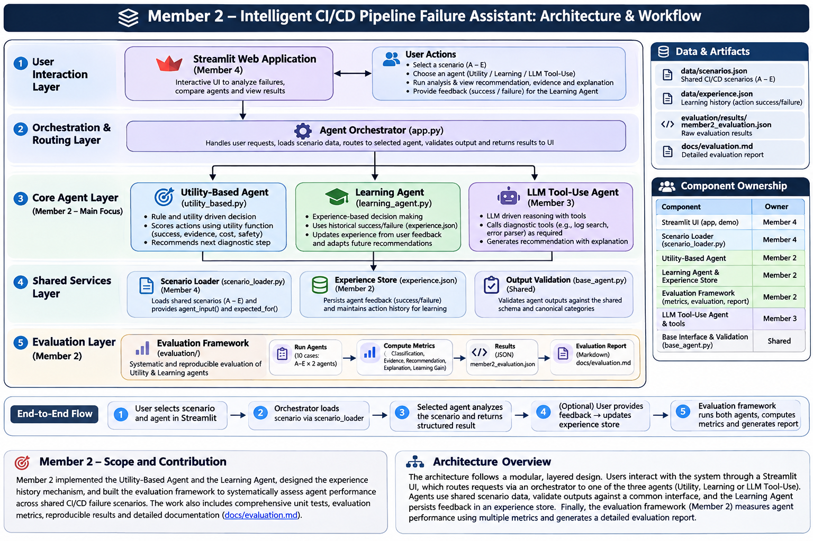

# Member 2 — Utility-Based Agent, Learning Agent & Evaluation

**Project:** Intelligent CI/CD Pipeline Failure Assistant  
**Group:** Group 5  
**Owner:** Avinash  
**Git Branch:** `2025paml613_Avinash`  
**Status:** Completed

---

## Table of Contents

- [1. Scope and Responsibilities](#1-scope-and-responsibilities)
- [2. Project Structure Owned by Member 2](#2-project-structure-owned-by-member-2)
- [3. Shared Project Requirements](#3-shared-project-requirements)
  - [3.1 Shared Scenarios](#31-shared-scenarios)
  - [3.2 Shared Input Schema](#32-shared-input-schema)
  - [3.3 Shared Output Schema](#33-shared-output-schema)
- [4. Utility-Based Agent](#4-utility-based-agent)
  - [4.1 Objective](#41-objective)
  - [4.2 Utility Formula](#42-utility-formula)
  - [4.3 Implementation Decisions](#43-implementation-decisions)
  - [4.4 Shared Interface Alignment](#44-shared-interface-alignment)
  - [4.5 Assumptions and Limitations](#45-assumptions-and-limitations)
- [5. Learning Agent](#5-learning-agent)
- [6. Experience History](#6-experience-history)
- [7. Evaluation Strategy](#7-evaluation-strategy)
- [8. Alignment Required from Other Members](#8-alignment-required-from-other-members)
  - [Member 1 — Classical Agents](#member-1--classical-agents)
  - [Member 3 — LLM Agent](#member-3--llm-agent)
  - [Member 4 — Integration and UI](#member-4--integration-and-ui)
- [9. Development and Git Workflow](#9-development-and-git-workflow)
- [10. Development Progress](#10-development-progress)
- [11. Technical Decision Log](#11-technical-decision-log)
- [12. Utility-Based Agent — Initial Execution Results](#12-utility-based-agent--initial-execution-results)
  - [12.1 Execution Environment](#121-execution-environment)
  - [12.2 Execution Results](#122-execution-results)
  - [12.3 Observations](#123-observations)
  - [12.4 Validation Summary](#124-validation-summary)
  - [12.5 Current Limitations](#125-current-limitations)
  - [12.6 Follow-up Work](#126-follow-up-work)
- [13. Utility-Based Agent — Updated Shared-Interface Testing](#13-utility-based-agent--updated-shared-interface-testing)
  - [13.1 Testing Framework and Environment](#131-testing-framework-and-environment)
  - [13.2 Test Coverage](#132-test-coverage)
  - [13.3 Actual Utility Test Execution Results](#133-actual-utility-test-execution-results)
  - [13.4 Execution Analysis](#134-execution-analysis)
  - [13.5 Warning Observation](#135-warning-observation)
  - [13.6 Utility Test Summary](#136-utility-test-summary)
  - [13.7 Combined Member 2 Regression Suite](#137-combined-member-2-regression-suite)
- [14. Learning Agent — Implementation and Shared-Schema Validation](#14-learning-agent--implementation-and-shared-schema-validation)
  - [14.1 Implementation Overview](#141-implementation-overview)
  - [14.2 Learning and Evidence Ranking Formulas](#142-learning-and-evidence-ranking-formulas)
  - [14.3 Alignment with Member 4's Shared Schema](#143-alignment-with-member-4s-shared-schema)
  - [14.4 Automated Testing](#144-automated-testing)
  - [14.5 Controlled Before-and-After Learning Demonstration](#145-controlled-before-and-after-learning-demonstration)
  - [14.6 Limitations](#146-limitations)
- [15. Member 2 — Evaluation Framework and Results](#15-member-2--evaluation-framework-and-results)
  - [15.1 Evaluation Framework Architecture](#151-evaluation-framework-architecture)
  - [15.2 Evaluation Matrix](#152-evaluation-matrix)
  - [15.3 Metric Definitions](#153-metric-definitions)
  - [15.4 Actual Evaluation Results](#154-actual-evaluation-results)
  - [15.5 Scenario-Level Outcomes](#155-scenario-level-outcomes)
  - [15.6 Learning Before/After Evaluation](#156-learning-beforeafter-evaluation)
  - [15.7 Evaluation Tests and Complete Test Suite](#157-evaluation-tests-and-complete-test-suite)
  - [15.8 Interpretation and Limitations](#158-interpretation-and-limitations)
  - [15.9 Reproduction Commands and Output Files](#159-reproduction-commands-and-output-files)
  - [15.10 Next Steps](#1510-next-steps)

---

## 1. Scope and Responsibilities

Member 2 is responsible for implementing:

1. Utility-Based Agent
2. Learning Agent
3. Experience history and persistence
4. Evaluation metrics and results
5. Unit tests for the Utility-Based and Learning Agents

The implementation must follow the shared architecture and input/output contract agreed by the group.

## 2. Project Structure Owned by Member 2

```text
agents/
    utility_based.py
    learning_agent.py

data/
    experience.json

scenario_loader.py                 # Shared scenario loader supplied by Member 4

evaluation/
    metrics.py
    evaluate_agents.py
    results/
        member2_evaluation.json

tests/
    test_utility.py
    test_learning.py
    test_evaluation.py
    test_evaluate_agents.py

docs/
    evaluation.md

Part_2_ReadMe.md
```

### 2.1 Overall System Architecture

The following architecture diagram illustrates the end-to-end workflow of the Intelligent CI/CD Pipeline Failure Assistant. It shows how the shared scenario loader, evaluation orchestrator, Utility-Based Agent, Learning Agent, shared output validation, experience store, and evaluation framework interact.



*Figure: This architecture diagram highlights Member 2's contributions and the shared components integrated into the project.*

The architecture provides a high-level view of how scenarios are processed, diagnostic agents generate recommendations, feedback is used to improve future decisions, and evaluation metrics measure agent performance. The detailed evaluation methodology and measured results are available in [Section 15 – Evaluation Framework](#15-evaluation-framework) and [docs/evaluation.md](docs/evaluation.md).

## 3. Shared Project Requirements

All six agents must receive the same selected scenario snapshot. The comparison runner should provide an isolated/deep-copied scenario input to each agent and remove the grader-only `expected` block before calling `decide(scenario)`, as defined by Member 4's shared interface.

### 3.1 Shared Scenarios

The shared `data/scenarios.json` supplied by Member 4 currently contains five scenarios:

| Scenario | Type | Description | Expected category |
|---|---|---|---|
| A | Critical | Unit tests fail after a code change | `unit_test` |
| B | Critical | Dependency version is unavailable or incompatible | `dependency` |
| C | Critical | Deployment health checks fail after release | `deployment` |
| D | Edge | Test stage times out and diagnostic evidence is incomplete | `unknown` |
| E | Normal/control | All pipeline stages and health checks pass | `healthy` |

Scenarios A, B and C are the three primary failure scenarios. Scenarios D and E provide additional ambiguous/edge and healthy/control coverage.

### 3.2 Shared Input Schema

The project plan describes the scenario input fields as `id`, `name`, `failure_type`, `pipeline_status`, `build_logs`, `test_results`, `dependency_info`, `recent_changes` and `health_checks`.

The actual `scenarios.json` supplied by Member 4 currently uses the following fields:

- `id`, `name`, `scenario_type`, `description`, `pipeline_id`, `run_id`, `branch`
- `failure_type` and `pipeline_status` (`build`, `tests`, `deployment`)
- `build_logs`, `test_results`, `dependencies`, `recent_changes`, `health_checks`
- `deployment_logs`
- `expected` (grader-only; must be removed before the scenario is passed to an agent)

**Schema naming alignment:** the project plan names the dependency field `dependency_info`, while the current shared fixture uses `dependencies`. Both Member 2 agents support both names and treat them as aliases for the same logical evidence. The shared fixture uses `deployment_logs`; both agents also support the `runtime_logs` alias. Unknown or missing evidence is handled explicitly. Agents must not use the grader-only `expected` block to make decisions.

### 3.3 Shared Output Schema

Every agent implements:

```python
 decide(scenario: dict) -> dict
```

The seven required output fields defined in `agents/base_agent.py` are:

- `agent`
- `failure_category`
- `supporting_evidence`
- `likely_cause`
- `recommended_step`
- `reasoning`
- `verification_checklist`

The shared interface also defines optional fields. Member 2 uses:

- `utility_score` and `candidate_scores` for the Utility-Based Agent
- `experience_used` and `candidate_scores` for the Learning Agent

Member 4's `base_agent.py` provides `canonical_category()`, `validate_result()` and `normalize_result()` helpers. The canonical categories include `unit_test`, `dependency`, `deployment`, `healthy` and `unknown`.

## 4. Utility-Based Agent

### 4.1 Objective

Evaluate multiple troubleshooting actions and recommend the action with the highest utility score.

### 4.2 Utility Formula

U(a) = 0.4P + 0.3E + 0.2S - 0.1C

Where:

- P = Estimated probability of resolving the issue
- E = Relevance of available evidence
- S = Safety of the diagnostic action
- C = Cost of performing the action

All input values are normalized between 0 and 1.

### 4.3 Implementation Decisions

- Maintain separate candidate actions for unit-test, dependency and deployment failures.
- Calculate the utility score for every applicable action.
- Select the action with the highest utility.
- Resolve ties deterministically using candidate order.
- Return the score of every candidate for transparency.
- Include supporting scenario evidence in the output.
- Do not execute code modifications or deployments.
- Reuse Member 4's `canonical_category()` helper so category aliases are normalized consistently.
- Handle `unknown` with a safe request for additional evidence and `healthy` with a monitoring/no-troubleshooting recommendation.
- Support both `dependencies` and `dependency_info` as names for dependency evidence.
- Include `deployment_logs` and the `runtime_logs` alias when collecting supporting evidence.
- Keep the scenario input unchanged and do not use the grader-only `expected` block as evidence.

### 4.4 Shared Interface Alignment

The updated `agents/utility_based.py` returns all seven required fields from `agents/base_agent.py`. The updated tests validate its output against `validate_result()` for all five scenarios in Member 4's shared fixture.

The nine existing diagnostic action IDs and their descriptions remain unchanged. The original utility formula and predefined action parameters are also retained.

### 4.5 Assumptions and Limitations

The initial success probabilities, evidence relevance, safety and cost values are illustrative estimates for simulated scenarios. They are not measured production statistics.

The candidate action utility parameters remain predefined. Supporting evidence is extracted from the selected scenario, but the candidate `evidence_relevance` parameter in the utility catalog is not dynamically learned from that evidence. The agent recommends actions but does not execute fixes. Real-world CI/CD integration is outside the current implementation.

## 5. Learning Agent

**Status:** Implemented, aligned with Member 4's shared schema and locally tested.

Implemented capabilities:

- Maintain experience counts by failure category and diagnostic action.
- Track successful and unsuccessful troubleshooting outcomes.
- Calculate historical success rates using Laplace smoothing.
- Combine historical experience with action-specific evidence relevance when ranking applicable actions.
- Normalize categories using `canonical_category()` from `agents/base_agent.py`.
- Handle `unknown` with an uncertainty response and `healthy` with a monitoring/no-troubleshooting response.
- Support both `dependencies`/`dependency_info` and `deployment_logs`/`runtime_logs` aliases.
- Update history only after explicit Boolean feedback is provided.
- Persist experience in `data/experience.json` using a temporary file and atomic replacement.
- Refresh history before decisions so agent instances can observe persisted feedback updates.
- Keep grader-only `expected` data out of agent reasoning and preserve the input scenario.

The Learning Agent is advisory only. It does not modify code or deploy automatically.

## 6. Experience History

**Status:** Implemented, persisted and locally validated. The evaluator uses temporary experience files for reproducible baseline and feedback experiments; the project's persistent history is preserved.

The experience data uses JSON format and maintains counts for each action within each failure category.

Example structure:

```json
{
  "unit_test": {
    "inspect_tests": {
      "success": 0,
      "failure": 0
    },
    "inspect_changes": {
      "success": 0,
      "failure": 0
    },
    "inspect_pipeline": {
      "success": 0,
      "failure": 0
    }
  }
}
```

The actual `data/experience.json` includes all nine diagnostic actions across `unit_test`, `dependency` and `deployment`. Initial counts are zero; outcomes are updated only after explicit success/failure feedback. The demonstration uses a temporary experience file so it does not alter the project's persistent history.

## 7. Evaluation Strategy

**Status:** Implemented and executed in the Windows project environment.

The primary evaluation covers two Member 2 agents across three primary scenarios, resulting in six primary agent-scenario cases (Utility-Based and Learning Agents × A, B and C). Scenarios D (ambiguous/edge) and E (healthy/control) are also evaluated, giving ten total agent-scenario executions.

Evaluation metrics:

1. Failure classification correctness using `canonical_category()`.
2. Evidence relevance using precision, recall and F1 against an evaluator-authored scenario evidence mapping.
3. Recommendation appropriateness against `expected.acceptable_next_steps` using deterministic phrase matching.
4. Explanation completeness using a four-point rubric.
5. Learning before/after feedback using a separate controlled simulated-feedback experiment.

The evaluator retains `expected` for scoring and removes it from all agent inputs. Each agent receives an independent deep copy of the same scenario. Learning baseline evaluations use fresh temporary zero-count experience files.

Actual evaluation results and methodology are documented in `docs/evaluation.md`; raw outputs are saved in `evaluation/results/member2_evaluation.json`. The evidence reference mapping and scoring rubrics are explicit implementation choices, not production measurements.

## 8. Alignment Required from Other Members

### Member 1 — Classical Agents

- Confirm the agreed failure category names.
- Confirm how their three agents represent scenario evidence.
- Ensure output compatibility with the common agent contract.

### Member 3 — LLM Agent

- Confirm diagnostic action/tool naming where shared.
- Ensure evidence and failure categories remain consistent.
- Coordinate evaluation of evidence-grounded LLM recommendations.

### Member 4 — Integration and UI

Member 4 (Karthik) has supplied:

- `agents/base_agent.py`, including the required output fields, optional fields, canonical category mapping and result validation/normalization helpers.
- `data/scenarios.json`, containing Scenarios A, B, C, D and E.

Member 4 (Karthik) has also supplied the root-level `scenario_loader.py`. The Member 2 evaluator now uses this shared loader through `load_scenarios()`, `scenario_ids()`, `agent_input()` and `expected_for()`. The earlier evaluator-side `evaluation/scenario_adapter.py` has been removed, avoiding duplicate scenario-loading logic.

Remaining coordination items:

- Confirm whether `dependencies` in the current fixture or `dependency_info` from the project plan will be the canonical dependency field. Both Member 2 agents currently support both aliases.
- Confirm how the Streamlit runner invokes each agent and displays optional fields such as `utility_score`, `candidate_scores` and `experience_used`.
- Coordinate the Learning Agent feedback mechanism in the UI.

Full group integration and Streamlit end-to-end validation remain team-level activities.

## 9. Development and Git Workflow

Current branch: `2025paml613_Avinash`

Development will take place independently on this branch.

Planned commits:

- Implement Utility-Based Agent
- Add Utility-Based Agent tests
- Implement Learning Agent
- Add experience persistence
- Add Learning Agent tests
- Implement evaluation metrics
- Add evaluation documentation

All completed changes will be pushed to the existing branch and submitted through a pull request for review and merging into `main`.

---

## 10. Development Progress

| Component | Status |
|-----------|--------|
| Member 2 folder structure | Completed |
| Utility-Based Agent implementation | Completed |
| Utility-Based Agent manual execution (A, B and C) | Completed |
| Utility-Based Agent shared-interface alignment with Member 4's `base_agent.py` | Completed and tested |
| Utility-Based Agent support for shared scenarios A–E | Completed and tested |
| Utility-Based Agent automated tests | Completed — 38 passed |
| Learning Agent implementation | Completed |
| Experience history and JSON persistence | Completed and tested |
| Learning Agent shared-schema alignment for A–E | Completed and tested |
| Learning Agent before/after feedback demonstration | Completed with controlled simulated feedback |
| Learning Agent automated tests | Completed — 71 passed |
| Combined Utility and Learning regression tests | Completed — 109 passed before evaluator tests were added |
| Member 4 shared `scenario_loader.py` integration | Completed and tested |
| Evaluation metrics module | Completed and tested |
| Evaluation orchestrator for A–E | Completed — 10 evaluations |
| Evaluation-specific automated tests | Completed — 20 passed |
| Complete Member 2 test suite | Completed — 129 passed |
| Evaluation results JSON | Generated from local Windows execution |
| Evaluation documentation (`docs/evaluation.md`) | Completed with actual Windows results |
| Full group integration and Streamlit validation | Pending team integration |

Latest local Windows validation after shared-loader migration: 129 tests passed, 0 failed, with one non-blocking AnyIO/pytest deprecation warning. The evaluator completed ten agent-scenario executions with valid output contracts and no agent execution errors.

## 11. Technical Decision Log

| Decision | Rationale |
|---|---|
| Use Python dictionaries for scenario input | Matches the shared `decide(scenario)` contract |
| Reuse Member 4's `base_agent.py` category and validation helpers | Keeps category normalization and output validation consistent across agents |
| Support both `dependencies` and `dependency_info` in the Utility-Based Agent | Handles the current fixture and the project-plan field name |
| Include `deployment_logs` and `runtime_logs` alias in Utility-Based Agent evidence | Preserves deployment/runtime diagnostic evidence |
| Handle `unknown` and `healthy` as distinct categories | Avoids overconfident diagnosis and troubleshooting of a healthy pipeline |
| Use predefined utility candidate actions | Provides a reproducible baseline |
| Normalize utility parameters to 0–1 | Consistent utility calculations |
| Return all candidate scores | Explainable decisions |
| Use JSON for experience history | Simple persistent storage |
| Accept explicit feedback for learning | Prevents recommendations from being falsely counted as successful outcomes |
| Use atomic replacement when saving experience | Reduces the risk of leaving a partially written JSON history file |
| Keep grader-only `expected` data out of agent reasoning | Prevents evaluation leakage |
| Reuse Member 4's root-level `scenario_loader.py` | Keeps scenario loading, deep-copy isolation and evaluator-only expected-data separation in one shared component |
| Keep metric calculations in `evaluation/metrics.py` | Separates scoring rules from orchestration and makes metrics independently testable |
| Store raw evaluation details in JSON | Preserves per-case outputs, metric components, validation and errors for auditability |
| Use fresh temporary Learning Agent histories for baseline cases | Prevents feedback from one baseline scenario affecting another |
| Report evidence mapping and recommendation matching as explicit rubrics | Makes the judgement-based evaluation rules transparent |

## 12. Utility-Based Agent — Initial Execution Results

**Implementation status:** Successfully executed.

### 12.1 Execution Environment

- Python implementation: `agents/utility_based.py`
- Demonstration script: `tmp/run_utility_demo.py`
- Execution command: `python tmp/run_utility_demo.py`
- Scenarios tested: A, B and C

### 12.2 Execution Results

| Scenario | Selected Action | Utility Score |
|---|---|---:|
| A — Unit Test Failure | Inspect failed unit test results | 0.805 |
| B — Dependency Failure | Check dependency versions and compatibility | 0.834 |
| C — Deployment Health Failure | Inspect deployment health-check results | 0.834 |

### 12.3 Observations

**Scenario A:** The agent selected inspection of failed unit tests because this action achieved the highest utility score. The scenario showed that the build passed but two unit tests failed.

**Scenario B:** The agent selected dependency version and compatibility inspection. This was the highest-scoring action for the dependency resolution failure.

**Scenario C:** The agent selected deployment health-check inspection because the application passed its tests but returned HTTP 503 after deployment.

### 12.4 Validation Summary

- Three scenarios successfully processed.
- Nine candidate actions evaluated.
- Highest utility action selected in all three scenarios.
- Supporting evidence returned.
- Reasoning and candidate scores returned.
- Common agent response structure maintained.

### 12.5 Current Limitations

- Utility parameters are illustrative estimates, not measured production statistics.
- Utility values, including each candidate action's `evidence_relevance`, are predefined in the action catalog.
- The agent extracts and returns scenario-specific supporting evidence, but it does not dynamically learn or calculate the utility catalog's evidence-relevance parameter.
- In a real-world CI/CD troubleshooting platform, utility parameters could be informed by operational data, historical incidents, monitoring systems and engineering policies.
- The agent recommends actions but does not execute fixes.
- The current project uses simulated scenario fixtures rather than a live CI/CD system.

### 12.6 Follow-up Work

1. Align the Learning Agent with Member 4's shared input schema and canonical categories.
2. Extend Learning Agent tests to cover scenarios A–E, dependency field aliases and deployment logs.
3. Evaluate both Member 2 agents across the three primary scenarios and the additional edge/healthy scenarios.
4. Implement the evaluation framework and document actual results in `docs/evaluation.md`.

## 13. Utility-Based Agent — Updated Shared-Interface Testing

### 13.1 Testing Framework and Environment

- Framework: pytest
- Python version: 3.12.9
- Pytest version: 9.2.0
- Test file: `tests/test_utility.py`
- Execution environment: Windows
- Execution command:

```powershell
python -m pytest tests/test_utility.py -v
```

### 13.2 Test Coverage

The updated suite contains 20 test functions and 38 individual executions, including parameterized cases.

| Test ID | Test Description | Executions | Result |
|---|---|---:|---|
| UT-01 | Utility formula calculation | 1 | PASS |
| UT-02 | Best action selection for primary scenarios A, B and C | 3 | PASS |
| UT-03 | Canonical failure-category normalization (`unit_test`, `dependency`, `deployment`, `none`, `healthy`, `unknown`, `ambiguous`) | 7 | PASS |
| UT-04 | Standard output structure | 1 | PASS |
| UT-05 | Candidate scores within theoretical utility range | 3 | PASS |
| UT-06 | Missing utility parameter | 1 | PASS |
| UT-07 | Invalid utility values | 6 | PASS |
| UT-08 | Unknown scenario safe fallback | 1 | PASS |
| UT-09 | Healthy scenario does not recommend troubleshooting | 1 | PASS |
| UT-10 | Invalid scenario input types | 4 | PASS |
| UT-11 | `dependency_info` alias support | 1 | PASS |
| UT-12 | Shared fixture `dependencies` field support | 1 | PASS |
| UT-13 | Dependency aliases do not duplicate identical evidence | 1 | PASS |
| UT-14 | `deployment_logs` included in supporting evidence | 1 | PASS |
| UT-15 | `runtime_logs` alias support | 1 | PASS |
| UT-16 | Grader-only `expected` block is not returned as supporting evidence | 1 | PASS |
| UT-17 | Scenario input is not mutated | 1 | PASS |
| UT-18 | Deterministic tie-breaking uses catalog order | 1 | PASS |
| UT-19 | Empty and missing evidence handling | 1 | PASS |
| UT-20 | All five shared scenarios satisfy the output contract | 1 | PASS |
| **Total** | **20 test functions** | **38** | **ALL PASS** |

Note: Parameterized tests generate multiple individual executions from a single test function.

### 13.3 Actual Utility Test Execution Results

Command:

```powershell
python -m pytest tests/test_utility.py -v
```

Actual terminal summary from the Windows project environment:

```text
collected 38 items

38 passed, 1 warning in 0.10s
```

### 13.4 Execution Analysis

All 38 individual test cases passed successfully. The tests confirm:

1. Correct mathematical utility calculation and highest-scoring action selection for scenarios A, B and C.
2. Canonical category handling, including `healthy` and `unknown`.
3. Compliance with the seven required output fields defined by Member 4's `base_agent.py`.
4. Candidate utility score validation and rejection of missing/invalid utility parameters.
5. Safe handling of invalid scenario input, unsupported categories and healthy pipelines.
6. Support for both `dependencies` and `dependency_info` without duplicating identical evidence.
7. Inclusion of `deployment_logs` and the `runtime_logs` alias in supporting evidence.
8. Exclusion of the grader-only `expected` block from returned supporting evidence.
9. No mutation of the input scenario.
10. Deterministic tie-breaking and safe handling of missing evidence.
11. Output-contract validation for all five shared scenarios A–E.

### 13.5 Warning Observation

One non-blocking deprecation warning was reported by the installed AnyIO pytest plugin. It concerns the deprecated `CallSpec2` alias and does not affect the successful test execution.

### 13.6 Utility Test Summary

| Metric | Actual Result |
|---|---:|
| Test functions | 20 |
| Individual test executions | 38 |
| Passed | 38 |
| Failed | 0 |
| Warnings | 1 |
| Execution time | 0.10 seconds |

Automated test success rate: 100%.

### 13.7 Combined Member 2 Regression Suite

After adding the evaluator tests, the complete Member 2 test suite was executed:

```powershell
python -m pytest -v
```

Actual terminal summary from the Windows project environment:

```text
collected 129 items

129 passed, 1 warning in 2.27s
```

The final combined result comprises 38 Utility-Based Agent test executions, 71 Learning Agent test executions and 20 evaluation-framework test executions. All 129 passed. The single warning is the non-blocking AnyIO/pytest deprecation warning described above.

## 14. Learning Agent — Implementation and Shared-Schema Validation

### 14.1 Implementation Overview

The Learning Agent is implemented in `agents/learning_agent.py`. It reuses the action catalog from `agents/utility_based.py` so both Member 2 agents use consistent diagnostic action IDs and descriptions.

Implemented capabilities:

- Load and validate historical success/failure counts from `data/experience.json`.
- Initialize a complete zero-count experience structure when the file is missing.
- Persist experience updates through a temporary file followed by atomic replacement.
- Calculate historical success rates using Laplace smoothing.
- Calculate action-specific evidence relevance from populated scenario fields and matching diagnostic keywords.
- Rank applicable actions using both historical outcomes and scenario evidence.
- Accept explicit Boolean success/failure feedback only; recommendations do not update experience.
- Refresh history before decisions and feedback updates so an agent instance can observe updates persisted by another instance.
- Normalize failure categories through `canonical_category()` from `agents/base_agent.py`.
- Handle `unknown` with an uncertainty response and `healthy` with a monitoring/no-troubleshooting response.
- Support `dependencies`/`dependency_info` and `deployment_logs`/`runtime_logs` aliases.
- Keep grader-only `expected` data out of agent reasoning and preserve the input scenario.

### 14.2 Learning and Evidence Ranking Formulas

Laplace-smoothed historical success rate:

`H = (success + 1) / (success + failure + 2)`

Evidence relevance:

`E = 0.60 * relevant_field_coverage + 0.40 * keyword_coverage`

Combined action ranking:

`L = 0.60 * H + 0.40 * E`

The 60% historical-experience and 40% evidence-relevance weights are explicit implementation choices. They are not fixed values specified by the assignment. The combined score is a relative action-ranking score, not a calibrated probability of resolving a CI/CD failure.

### 14.3 Alignment with Member 4's Shared Schema

The Learning Agent accepts the shared scenario dictionary through `decide(scenario)` and returns all seven mandatory fields defined by `agents/base_agent.py`:

- `agent`
- `failure_category`
- `supporting_evidence`
- `likely_cause`
- `recommended_step`
- `reasoning`
- `verification_checklist`

Learning-specific optional fields include `experience_used`, `candidate_scores`, `selected_action_id`, `success_rate` and `learning_score`.

The implementation supports the five canonical categories:

- `unit_test`
- `dependency`
- `deployment`
- `unknown`
- `healthy`

It supports both dependency field names (`dependencies` and `dependency_info`) as one logical evidence group, and both runtime/deployment log names (`deployment_logs` and `runtime_logs`). It does not use the grader-only `expected` block.

### 14.4 Automated Testing

**Environment:** Windows, Python 3.12.9, pytest 9.2.0.  
**Test file:** `tests/test_learning.py`  
**Command:** `python -m pytest tests/test_learning.py -v`

Actual terminal summary:

```text
collected 71 items

71 passed, 1 warning in 0.76s
```

The 71 executions cover experience initialization, Laplace smoothing, invalid counts, output fields, evidence relevance, feedback updates, persistence across agent instances, recommendation changes after feedback, invalid feedback, category normalization, unknown/healthy handling, dependency and deployment aliases, expected-data exclusion, scenario immutability, atomic persistence and all five shared scenarios.

### 14.5 Controlled Before-and-After Learning Demonstration

The Scenario A demonstration uses a separate temporary experience file and controlled simulated feedback.

| Stage | Action | Feedback | Resulting history |
|---|---|---|---|
| Baseline | `inspect_tests` | None | 0 successes, 0 failures |
| Feedback 1 | `inspect_tests` | Simulated unsuccessful | 0 successes, 1 failure |
| Feedback 2 | `inspect_changes` | Simulated successful | 1 success, 0 failures |
| After feedback | `inspect_changes` | New recommendation | Recommendation changed |

The baseline recommendation was `Inspect failed unit test results`. After the simulated feedback, the agent recommended `Review recently modified code`. The evaluator confirmed that the new recommendation matched an acceptable Scenario A next step.

The experiment does not represent production incident history and does not modify the project's actual `data/experience.json`.

### 14.6 Limitations

- Feedback in the demonstration is simulated, not derived from production incident outcomes.
- Evidence relevance uses configured field groups and keyword matching, not a trained semantic model.
- The 60:40 learning-score weights are design choices and have not been tuned using a production dataset.
- The agent recommends diagnostic actions but does not execute fixes or deployments.

## 15. Member 2 — Evaluation Framework and Results

### 15.1 Evaluation Framework Architecture

The evaluation framework separates shared scenario loading, agent execution, metric calculation and result reporting.

Implemented files:

- `scenario_loader.py` (project root, Member 4) — provides `load_scenarios()`, `scenario_ids()`, `agent_input()` and `expected_for()`. It returns deep-copied scenario data and removes the grader-only `expected` block from agent inputs.
- `evaluation/metrics.py` — calculates classification correctness, evidence precision/recall/F1, recommendation appropriateness, explanation completeness and output-contract validity.
- `evaluation/evaluate_agents.py` — orchestrates both agents over Scenarios A–E using the shared loader and runs the separate before/after learning experiment.
- `evaluation/results/member2_evaluation.json` — stores raw agent outputs, per-case metrics, agent summaries, shared-loader metadata and learning experiment details.
- `tests/test_evaluation.py` and `tests/test_evaluate_agents.py` — validate loader integration, metric calculations and evaluator behaviour.
- `docs/evaluation.md` — contains the detailed evaluation methodology, actual Windows results, metric definitions, learning experiment, limitations and reproduction commands.

**Detailed evaluation report:** [docs/evaluation.md](docs/evaluation.md) contains the full methodology and measured results. This Section 15 provides the project-level summary; the linked report is its detailed companion and the single source of truth for evaluation methodology and results.

The evaluator now uses Member 4's shared `scenario_loader.py`; the earlier evaluator-side `evaluation/scenario_adapter.py` has been removed. Agent inputs are obtained through `agent_input()`, while expected outcomes are obtained separately through `expected_for()` and remain evaluator-only.

### 15.2 Evaluation Matrix

| Evaluation group | Scenarios | Agents | Executions |
|---|---|---|---:|
| Primary | A, B, C | Utility-Based and Learning | 6 |
| Robustness/control | D, E | Utility-Based and Learning | 4 |
| **Total** | **A–E** | **2** | **10** |

### 15.3 Metric Definitions

1. **Failure classification correctness:** canonical agent category matches the scenario's expected category.
2. **Evidence relevance:** precision, recall and F1 against an evaluator-authored, scenario-specific logical evidence mapping. Dependency and deployment-log aliases are normalized.
3. **Recommendation appropriateness:** the recommendation matches at least one phrase in `expected.acceptable_next_steps` using case-insensitive token matching and light suffix normalization.
4. **Explanation completeness:** four binary checks covering a meaningful likely cause, informative reasoning, decision rationale and actionable verification checklist.
5. **Learning before/after feedback:** a separate Scenario A experiment checks whether simulated explicit feedback changes a future recommendation.

The reference evidence mapping and matching/rubric rules are documented implementation choices. They are not production measurements. Aggregate evidence metrics are macro-averages of per-scenario values.

### 15.4 Actual Evaluation Results

The evaluator was run in the Windows project repository using Python 3.12.9. It completed ten evaluations: five scenarios for each agent. All ten outputs passed the shared output contract, all ten scenario inputs remained unchanged, and no agent execution errors were recorded.

**All five scenarios:**

| Agent | Cases | Classification accuracy | Evidence precision | Evidence recall | Evidence F1 | Recommendation appropriateness | Explanation completeness |
|---|---:|---:|---:|---:|---:|---:|---:|
| Utility-Based | 5 | 100.00% | 83.43% | 100.00% | 90.68% | 100.00% | 100.00% |
| Learning-Based | 5 | 100.00% | 83.43% | 100.00% | 90.68% | 100.00% | 100.00% |

**Primary and robustness results:**

| Agent | Group | Cases | Classification accuracy | Mean evidence precision | Mean evidence recall | Mean evidence F1 | Recommendation appropriateness | Explanation completeness |
|---|---|---:|---:|---:|---:|---:|---:|---:|
| Utility-Based | Primary A–C | 3 | 100.00% | 81.90% | 100.00% | 90.03% | 100.00% | 100.00% |
| Utility-Based | Robustness D–E | 2 | 100.00% | 85.72% | 100.00% | 91.66% | 100.00% | 100.00% |
| Learning-Based | Primary A–C | 3 | 100.00% | 81.90% | 100.00% | 90.03% | 100.00% | 100.00% |
| Learning-Based | Robustness D–E | 2 | 100.00% | 85.72% | 100.00% | 91.66% | 100.00% | 100.00% |

### 15.5 Scenario-Level Outcomes

| Scenario | Expected category | Utility-Based recommendation | Learning recommendation | Result |
|---|---|---|---|---|
| A | `unit_test` | Inspect failed unit test results | Inspect failed unit test results | Both appropriate |
| B | `dependency` | Check dependency versions and compatibility | Check dependency versions and compatibility | Both appropriate |
| C | `deployment` | Inspect deployment health-check results | Inspect deployment health-check results | Both appropriate |
| D | `unknown` | Collect complete pipeline logs and diagnostic reports, then rerun the affected pipeline stage with sufficient logging | Collect complete pipeline logs and the missing diagnostic report, then rerun the affected stage with sufficient logging | Both appropriate uncertainty responses |
| E | `healthy` | No troubleshooting action required; continue monitoring pipeline health | No troubleshooting action required; continue monitoring pipeline health | Both appropriate monitoring responses |

### 15.6 Learning Before/After Evaluation

The evaluator ran a separate Scenario A experiment with a temporary zero-count experience file:

- Baseline action: `inspect_tests` — Inspect failed unit test results.
- Simulated unsuccessful feedback for `inspect_tests`: success 0, failure 1; smoothed rate 0.3333.
- Simulated successful feedback for `inspect_changes`: success 1, failure 0; smoothed rate 0.6667.
- After-feedback action: `inspect_changes` — Review recently modified code.
- Recommendation changed: Yes.
- After-feedback recommendation appropriate: Yes.
- Real project experience file modified: No.

This confirms the intended feedback-driven behaviour under a controlled simulated experiment.

### 15.7 Evaluation Tests and Complete Test Suite

Evaluation-specific command:

```powershell
python -m pytest tests/test_evaluation.py tests/test_evaluate_agents.py -v
```

Actual Windows result after shared-loader migration:

```text
collected 20 items

20 passed, 1 warning in 0.49s
```

Complete Member 2 command:

```powershell
python -m pytest -v
```

Actual Windows result:

```text
collected 129 items

129 passed, 1 warning in 2.27s
```

| Test suite | Executions | Passed | Failed |
|---|---:|---:|---:|
| Utility-Based Agent | 38 | 38 | 0 |
| Learning Agent | 71 | 71 | 0 |
| Evaluation framework | 20 | 20 | 0 |
| **Total** | **129** | **129** | **0** |

The test runs reported one non-blocking AnyIO pytest-plugin deprecation warning concerning the `CallSpec2` alias. It did not affect the results.

### 15.8 Interpretation and Limitations

- Both agents achieved identical aggregate scores in this baseline run. With zero-count historical experience, the Learning Agent starts from a neutral prior; both agents also expose the same relevant/present evidence sources in the current fixtures. Identical scores do not mean their decision algorithms are identical.
- Evidence recall was 100%, while precision was 83.43%. Some returned evidence sources were populated in the scenario but were not included in the evaluator's scenario-specific relevant-source reference mapping. This is a useful opportunity to make evidence selection more selective; it should not be hidden by changing the reference mapping after seeing the results.
- Recommendation appropriateness is based on deterministic phrase matching. It is not proof of real-world resolution.
- Explanation completeness is based on a four-point structural rubric and does not replace human semantic review.
- The scenarios are synthetic. Results must not be generalized to production CI/CD failure rates.
- Learning feedback is simulated and does not represent verified incident outcomes.
- The evidence reference mapping is evaluator-authored and should be reviewed if the scenario fixtures change.

### 15.9 Reproduction Commands and Output Files

The root-level `scenario_loader.py` supplied by Member 4 is the authoritative scenario loader. The evaluator reads the configured `data/scenarios.json` through this shared component; it no longer accepts a separate `--scenarios` override.

Run evaluation-specific tests:

```powershell
python -m pytest tests/test_evaluation.py tests/test_evaluate_agents.py -v
```

Run the evaluation:

```powershell
python -m evaluation.evaluate_agents
```

To change only the output JSON destination, use the supported `--output` option:

```powershell
python -m evaluation.evaluate_agents --output evaluation/results/member2_evaluation.json
```

Run the complete Member 2 test suite:

```powershell
python -m pytest -v
```

The evaluator writes its raw per-case output and metrics to `evaluation/results/member2_evaluation.json`. The full methodology and interpretation are maintained in [docs/evaluation.md](docs/evaluation.md).

The separate root-level `README_EVALUATION.md` was originally a package quick-start guide. Its useful structure, safeguards and run-command instructions have been incorporated into `docs/evaluation.md`. Maintaining both would duplicate documentation; `docs/evaluation.md` is now the single evaluation reference, and the separate quick-start file can be removed from the repository.

### 15.10 Next Steps

- Review evidence false positives and consider more selective evidence extraction in a future iteration, without retroactively changing the current evaluation rubric.
- Support full group integration and Streamlit end-to-end testing using Member 4's shared scenario loader.
- Review evidence false positives in a future iteration without retroactively changing the current evaluation rubric.
- Re-run evaluation if scenario fixtures or agent implementations change, and preserve the resulting JSON evidence.

**Document maintenance:** This document records Member 2 implementation decisions, local Windows test results and evaluation evidence. Update the relevant sections whenever code, scenarios, evaluation methodology or actual test results change.
