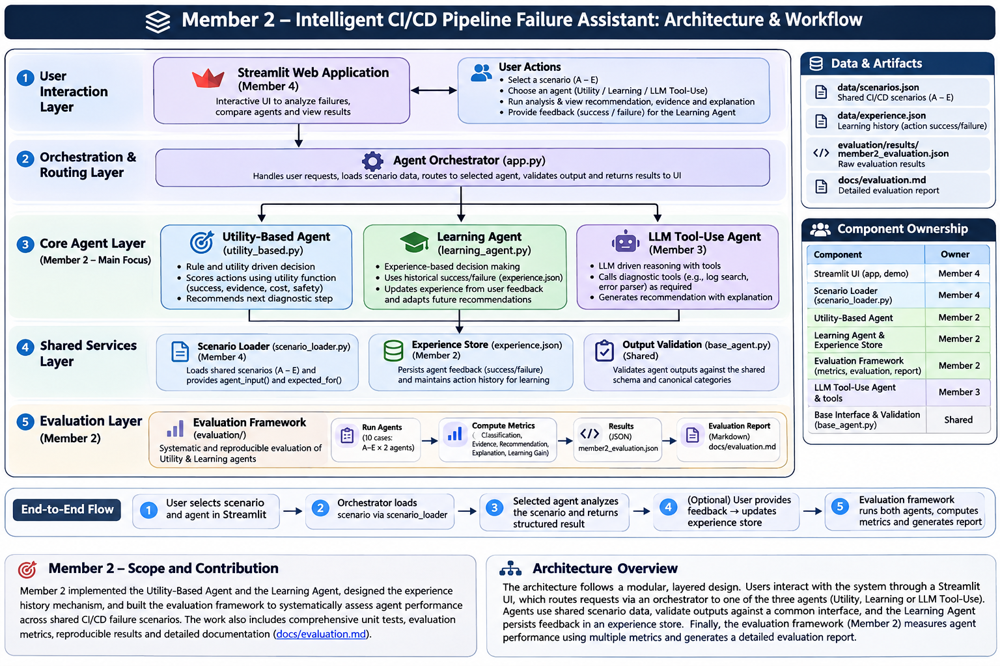
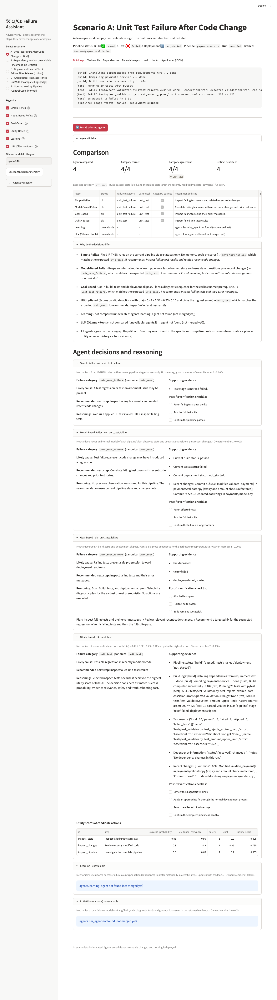
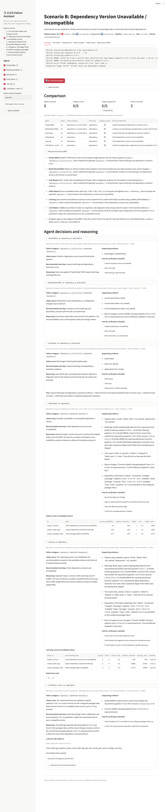
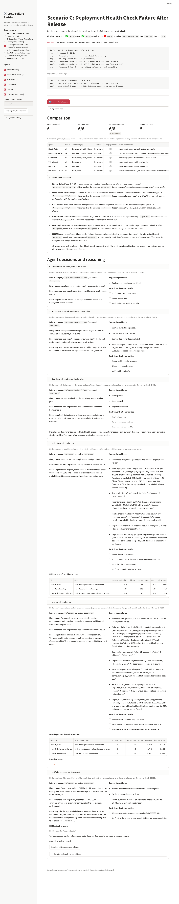
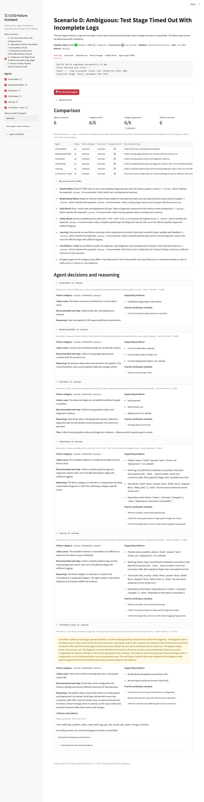
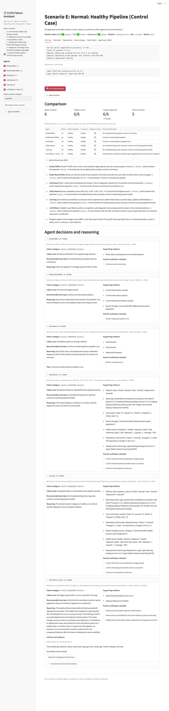

# AgenticAI-CICD-Assitant_Group5

**Intelligent CI/CD Pipeline Failure Assistant** - Agentic AI (S2-25_PCAMZG519), Assignment 1 set-2, Group 5.

An assistant that investigates failed build-and-deployment pipelines. It inspects build logs, test results,
dependency information and recent code changes, then recommends the next troubleshooting step **without changing
code or deploying automatically**.

Six agents receive the *same* scenario and their decisions are compared side by side in a Streamlit dashboard:

| # | Agent | Decision mechanism | File | Owner |
|---|---|---|---|---|
| 1 | Simple Reflex | Fixed IF-THEN rules on current stage statuses | `agents/simple_reflex.py` | Member 1 (Shubhra Shrivastava) |
| 2 | Model-Based Reflex | Remembers each pipeline's last state; uses transitions + recent changes | `agents/model_based.py` | Member 1 (Shubhra Shrivastava) |
| 3 | Goal-Based | Plans diagnostic steps toward the goal "build, tests and deployment pass" | `agents/goal_based.py` | Member 1 (Shubhra Shrivastava) |
| 4 | Utility-Based | Scores actions with `U(a) = 0.4P + 0.3E + 0.2S - 0.1C`, picks the max | `agents/utility_based.py` | Member 2 (Avinash Kumar Barnwal) |
| 5 | Learning | Uses/updates success-failure counts per action (`data/experience.json`) | `agents/learning_agent.py` | Member 2 (Avinash Kumar Barnwal) |
| 6 | LLM | Local Ollama model via LangChain, calls >= 2 diagnostic tools, grounds answer in tool output | `agents/llm_agent.py`, `tools/pipeline_tools.py` | Member 3 (ABIJITH M G) |

Every agent returns: failure category, supporting evidence, likely cause, recommended next step, reasoning and a
post-fix verification checklist.

This README consolidates the whole project: shared setup first, then each member's part in order
(Part 1 to Part 4). It merges the former `README_Part1.md` and `Part_2_ReadMe.md`.

## Table of contents

- [Team members and contributions](#team-members-and-contributions)
- [Project links](#project-links)
- [Setup](#setup)
- [Run](#run)
- [Tests](#tests)
- [Part 1 - Classical agents (Member 1: Shubhra Shrivastava)](#part-1--classical-agents-member-1-shubhra-shrivastava)
- [Part 2 - Utility-Based agent, Learning agent and evaluation (Member 2: Avinash Kumar Barnwal)](#part-2--utility-based-agent-learning-agent-and-evaluation-member-2-avinash-kumar-barnwal)
- [Part 3 - LLM agent with Ollama and tool calling (Member 3: ABIJITH M G)](#part-3--llm-agent-with-ollama-and-tool-calling-member-3-abijith-m-g)
- [Part 4 - Integration, Streamlit UI and comparison (Member 4: Karthikeyan B)](#part-4--integration-streamlit-ui-and-comparison-member-4-karthikeyan-b)
  - [Per-scenario comparison and why the decisions differ](#per-scenario-comparison-and-why-the-decisions-differ)
- [Known limitations](#known-limitations)

## Team members and contributions

| Member | Student ID / branch | Part | Contribution | Key files |
|---|---|---|---|---|
| **Member 1 - Shubhra Shrivastava** | `2025paml620_Shubhra` | [Part 1](#part-1--classical-agents-member-1-shubhra-shrivastava) | Simple Reflex, Model-Based Reflex and Goal-Based agents; classical-agent unit tests (10 test methods) | [`agents/simple_reflex.py`](agents/simple_reflex.py), [`agents/model_based.py`](agents/model_based.py), [`agents/goal_based.py`](agents/goal_based.py), [`tests/test_classical.py`](tests/test_classical.py) |
| **Member 2 - Avinash Kumar Barnwal** | `2025paml613_Avinash` | [Part 2](#part-2--utility-based-agent-learning-agent-and-evaluation-member-2-avinash-kumar-barnwal) | Utility-Based and Learning agents, experience history (`data/experience.json`), evaluation metrics and report; 129 tests | [`agents/utility_based.py`](agents/utility_based.py), [`agents/learning_agent.py`](agents/learning_agent.py), [`evaluation/metrics.py`](evaluation/metrics.py), [`evaluation/evaluate_agents.py`](evaluation/evaluate_agents.py), [`docs/evaluation.md`](docs/evaluation.md) |
| **Member 3 - ABIJITH M G** | `2025paml617_Abijith` | [Part 3](#part-3--llm-agent-with-ollama-and-tool-calling-member-3-abijith-m-g) | Local Ollama LLM agent via LangChain, four read-only diagnostic tools, citation/grounding validation, LLM tests and recorded live runs | [`agents/llm_agent.py`](agents/llm_agent.py), [`tools/pipeline_tools.py`](tools/pipeline_tools.py), [`tests/test_llm.py`](tests/test_llm.py), [`evaluation/results/member3_live.json`](evaluation/results/member3_live.json) |
| **Member 4 - Karthikeyan B** | `2025paml541_Karthik` | [Part 4](#part-4--integration-streamlit-ui-and-comparison-member-4-karthikeyan-b) | Shared scenarios A-E, common agent interface, scenario loader, runner, Streamlit UI, comparison report, integration tests, screenshots, consolidated README | [`data/scenarios.json`](data/scenarios.json), [`scenario_loader.py`](scenario_loader.py), [`agents/base_agent.py`](agents/base_agent.py), [`evaluation/runner.py`](evaluation/runner.py), [`evaluation/comparison.py`](evaluation/comparison.py), [`app.py`](app.py), [`tests/test_integration.py`](tests/test_integration.py) |

## Project links

| What | Link |
|---|---|
| GitHub repository | [https://github.com/2025paml620/AgenticAI-CICD-Assitant_Group5](https://github.com/2025paml620/AgenticAI-CICD-Assitant_Group5) |
| This README on GitHub | [https://github.com/2025paml620/AgenticAI-CICD-Assitant_Group5/blob/main/README.md](https://github.com/2025paml620/AgenticAI-CICD-Assitant_Group5/blob/main/README.md) |
| Agent comparison report | [docs/test_results/comparison_results.md](docs/test_results/comparison_results.md) |
| Integration test output | [docs/test_results/pytest_integration.txt](docs/test_results/pytest_integration.txt) |
| Part 1 evaluation (classical agents) | [evaluation/results/member1_evaluation.json](evaluation/results/member1_evaluation.json) |
| Part 2 evaluation report | [docs/evaluation.md](docs/evaluation.md) |
| Part 3 recorded LLM runs | [evaluation/results/member3_live.json](evaluation/results/member3_live.json) |
| Dashboard screenshots | [docs/screenshots/](docs/screenshots/) |
| Presentation | [docs/Group5_CICD_Assistant.pptx](docs/Group5_CICD_Assistant.pptx) |

## Setup

Python 3.10+ is required.

```bash
git clone https://github.com/2025paml620/AgenticAI-CICD-Assitant_Group5.git
cd AgenticAI-CICD-Assitant_Group5
python3 -m venv .venv
source .venv/bin/activate          # Windows: .venv\Scripts\activate
pip install -r requirements.txt
```

### Ollama (for the LLM agent)

```bash
# install from https://ollama.com, then:
ollama pull qwen3:4b               # or any tool-calling model that fits your RAM
ollama serve                       # if it is not already running as a service
ollama list
```

## Run

### Windows / PowerShell quick start

Run from the repository folder. These commands use the project interpreter
directly, so virtual-environment activation is not required:

```powershell
cd <path-to>\AgenticAI-CICD-Assitant_Group5
# Create the environment only if .venv does not already exist:
python -m venv .venv
.\.venv\Scripts\python.exe -m pip install -r requirements.txt -c constraints-windows.txt
.\.venv\Scripts\python.exe -m streamlit run app.py --server.address 127.0.0.1 --server.port 8501
```

Leave that terminal running and open **http://127.0.0.1:8501** in your browser.
Stop the server with Ctrl+C. If port 8501 is occupied, use `--server.port 8502`
and open http://127.0.0.1:8502 instead.

Test the flow in two steps:

1. Uncheck **LLM (Ollama + tools)**, choose scenario A, and click
   **Run all selected agents**. Check the comparison and agent decisions.
2. Start the Ollama application, run `ollama list` in another terminal, and
   run `ollama pull qwen3:4b` if the model is missing. Check the LLM agent again,
   enter `qwen3:4b` as the model, and rerun. Repeat for B and C. Expected categories
   are `unit_test`, `dependency`, and `deployment`. Expand the LLM decision and
   **Executed tools and returned evidence** to inspect actual calls; use
   **Download LLM diagnosis and full trace** to save the evidence.

If Ollama is not responding, run `ollama serve` in a separate terminal. If it
reports the address is already in use, Ollama is already serving.

Troubleshooting:

- **`streamlit` is not recognized / module not found:** use the full
  `.\.venv\Scripts\python.exe -m streamlit` command above and install requirements
  with that same interpreter. In PyCharm, select `.venv\Scripts\python.exe`.
- **NumPy/Pandas/PyArrow DLL import failure:** first stop every old Streamlit
  terminal with Ctrl+C and restart the app. A server started before package changes
  may retain old imports. Check fresh imports with
  `.\.venv\Scripts\python.exe -c "import pyarrow.compute, pandas; print('Imports OK')"`.
  The Windows constraints select the versions
  verified for this project. Repair the installation with
  `.\.venv\Scripts\python.exe -m pip install --force-reinstall -r requirements.txt -c constraints-windows.txt`.
  Windows previously blocked a binary from a newer NumPy wheel on this machine.
  If the fresh import still reports an Application Control block, retain the
  traceback and consult the device administrator; do not disable the policy.
- **Blank page / only a heading:** open the local URL above and check the terminal
  running Streamlit for its traceback. Start `app.py` with `-m streamlit run`,
  rather than running it as a plain Python script.
- **LLM error:** inspect the red error and partial tool trace. Confirm the model
  name matches `ollama list`, then reset agents and rerun. A failed diagnosis is
  reported as an error rather than counted as a successful comparison.

Verify locally:

```powershell
.\.venv\Scripts\python.exe -m pytest tests/test_integration.py -q
# Optional: real Ollama acceptance for A, B and C (can take several minutes):
$env:RUN_LLM_TESTS = '1'
.\.venv\Scripts\python.exe -m pytest tests/test_integration.py -k llm_agent_calls -v
Remove-Item Env:RUN_LLM_TESTS
```

### Other environments

```bash
streamlit run app.py
```

1. Pick a scenario (A-E) in the sidebar and tick the agents to compare.
2. Click **Run all selected agents**.
3. Read the summary metrics, the comparison table, *Why do the decisions differ?*, and each agent's
   evidence, reasoning, checklist, utility scores, experience and LLM tool calls.

`http://localhost:8501/?scenario=C&run=1` opens scenario C and runs it straight away.
**Reset agents** clears the Model-Based agent's memory and reloads all agents.

Regenerate the comparison report in `docs/test_results/comparison_results.md`:

```bash
python -m evaluation.comparison            # with the LLM (Ollama must be running)
python -m evaluation.comparison --no-llm   # classical agents only
```

## Tests

```bash
pytest -v                                         # all tests; LLM test skipped
RUN_LLM_TESTS=1 pytest -v tests/test_integration.py   # also checks the LLM calls >= 2 tools
```

`tests/test_integration.py` checks that:
- scenarios A, B, C exist with the right expected category, and normal/critical/edge cases are covered;
- the answer key is hidden from agents and each agent gets its own copy of the same input;
- every classical agent returns the full output contract on all five scenarios and classifies A-C correctly;
- the edge case D is not classified with false confidence;
- a missing or crashing agent is reported but does not break the run or the UI;
- a comparison report can be produced for every scenario.

Agents that are not merged yet are **skipped**, not failed.

---

## Part 1 — Classical agents (Member 1: Shubhra Shrivastava)

> **Final status (after merge):** all three classical agents are loaded by `evaluation/runner.py`, shown in the
> Streamlit dashboard, and classify scenarios A-E correctly (see [Part 4 results](#results)). The integration suite
> `tests/test_integration.py` passes in the merged repository. The pending items in 6.4 and 7 below are kept as
> Member 1's original working notes.

**Project:** Intelligent CI/CD Pipeline Failure Assistant  
**Repository:** `AgenticAI-CICD-Assistant_Group5`  
**Member 1:** Shubhra Shrivastava  
**Responsibility:** Classical AI agents, unit tests, and shared-scenario integration testing  
**Status:** Three agent modules implemented; Member 1 unit tests have shown passing results locally. Member 4 integration-test execution and full Streamlit verification require confirmation from the local test output.

### 1. Project context and objective

The project investigates simulated CI/CD failures and recommends the next safe troubleshooting step. Member 1 implements **three distinct classical agents** that inspect the same pipeline scenario but use different decision-making methods. All agents are advisory only: they **do not change code, run fixes, or deploy software**.

### 2. Files and ownership

| File | Contribution |
|---|---|
| `agents/simple_reflex.py` | Stateless, fixed condition–action rules for pipeline stage failures. |
| `agents/model_based.py` | Remembers previous observations by pipeline, identifies unchanged states/transitions, and supports reset. |
| `agents/goal_based.py` | Recommends a safe diagnostic plan to reach a healthy build → test → deployment state. |
| `tests/test_classical.py` | Independent unit tests for the three agents (10 test methods). |
| `tests/test_integration.py` | **Member 4-owned** integration tests reused by Member 1 to validate shared scenarios, scenario loading, and (where implemented) runner integration. Member 1 did not create a separate integration-test file. |
| `docs/README_Member1.md` | This contribution and testing guide (recommended repository destination). |

**Shared dependencies (Member 4):** `data/scenarios.json`, `scenario_loader.py`, `evaluation/runner.py`, `evaluation/comparison.py`, and `app.py`. These are **not** Member 1's deliverables.

### 3. Implementation summary

#### 3.1 Simple Reflex Agent

- Reads the current pipeline stage statuses, supporting nested `pipeline_status` and top-level stage fields.
- Uses fixed IF–THEN rules and stage priority (build before tests before deployment).
- Classifies unit-test, dependency/build, deployment, healthy, or unknown situations.
- Returns a diagnostic recommendation and explanation based on current evidence only.
- **No memory, learning, or planning** is performed.

#### 3.2 Model-Based Reflex Agent

- Maintains an in-memory observation history indexed by `pipeline_id` (or scenario `id`).
- Compares current and previous stage statuses, distinguishing first observation, unchanged status, and state transition.
- Uses recent-change context when available.
- Provides `reset()` to clear in-memory state for a new test/demo.
- **Limitation:** State is not persistent across process restarts and does not learn from outcome feedback.

#### 3.3 Goal-Based Agent

- Uses the target state: build, tests, and deployment all pass.
- Chooses a safe, predefined troubleshooting plan for the earliest unmet stage.
- Returns a `plan` list and uses its first step as `recommended_step`.
- Adds verification steps; plans are recommendations, not executable automation.
- **Limitation:** The agent does not perform general-purpose search or automatic remediation.

### 4. Shared input and output contract

All three agents implement:

```python
result = agent.decide(scenario_dict)
```

Example input (a simplified representation of Member 4's scenario schema):

```python
scenario = {
    "id": "A",
    "pipeline_id": "payments-service",
    "pipeline_status": {
        "build": "passed",
        "tests": "failed",
        "deployment": "not_started"
    },
    "recent_changes": ["Modified payment validation logic"]
}
```

Common result fields:

- `agent` — name of the decision-making agent
- `failure_category` — agent-specific category string
- `supporting_evidence` — evidence items used in diagnosis
- `likely_cause` — likely reason for the failure
- `recommended_step` — first recommended troubleshooting action
- `reasoning` — explanation of the decision
- `verification_checklist` — post-fix checks to recommend
- `plan` — extra list returned by the Goal-Based Agent

The input scenario should not be modified by the agent.

#### Category normalization for Member 4's evaluation

| Member 1 category | Canonical shared category |
|---|---|
| `unit_test_failure` | `unit_test` |
| `dependency_or_build_failure` | `dependency` |
| `deployment_health_failure` | `deployment` |
| `unknown` | `unknown` |
| `healthy` | `healthy` |

The additional Member 1 integration test explicitly maps these categories. **Confirm the same mapping in `evaluation/runner.py` before claiming full dashboard integration.**

### 5. Shared scenarios covered

Member 4's `data/scenarios.json` defines five simulated cases:

| ID | Scenario | Expected canonical category | Why it matters |
|---|---|---|---|
| A | Unit tests fail after code change | `unit_test` | Detect a regression after a successful build. |
| B | Dependency/version unavailable | `dependency` | Diagnose build-stage dependency resolution failure. |
| C | Deployment health checks fail | `deployment` | Identify a runtime/health-check issue after successful tests. |
| D | Test stage times out with incomplete logs | `unknown` | Avoid unsupported certainty when evidence is missing. |
| E | Healthy pipeline | `healthy` | Ensure agents do not invent a failure. |

The first three are required project failure cases; D is an edge case and E is a normal control case.

### 6. Testing strategy

#### 6.1 Unit testing — Member 1 agent behavior

`tests/test_classical.py` checks:

1. Classification across five pipeline conditions for each agent.
2. Required output fields and types.
3. Input immutability.
4. Support for flat stage-status fields.
5. Build failure priority.
6. Model-Based Agent memory for repeated observations.
7. State transition detection.
8. Isolation of state across pipeline IDs.
9. Memory reset.
10. Safe, nonempty Goal-Based troubleshooting plans.

From the **repository root**, run:

```powershell
python -m unittest discover -s tests -p "test_classical.py" -v
```

#### 6.2 Integration testing using Member 4's existing file

**Actual file used:** `tests/test_integration.py` (created and maintained by Member 4). Member 1 did **not** use or add `test_member1_integration.py`.

The visible portion of Member 4's test file checks:

- Required shared scenario IDs and expected failure categories.
- Presence of normal, critical, and edge-case scenarios.
- Correct pipeline statuses for scenarios A, B, and C.
- Removal of the `expected` answer from the agent input and isolation of the input copy.

Other integration tests may be present in that file; consult the complete local file and pytest output for the full test count and coverage. Passing this file alone does **not** prove that all three Member 1 agents are integrated into the runner unless tests explicitly exercise them.

From the repository root, run:

```powershell
python -m pytest tests/test_integration.py -v
```

#### 6.3 Run unit and integration tests together

```powershell
python -m pytest tests/test_classical.py tests/test_integration.py -v
```

To run every repository test:

```powershell
python -m pytest tests/ -v
```

If needed, install pytest with `python -m pip install pytest`.

#### 6.4 Validation evidence and status

- **Unit testing:** The provided VS Code screenshot shows Member 1's `test_classical.py` methods reporting `ok` for the visible cases. The complete final test summary should be saved as evidence.
- **Integration testing:** Member 4's `test_integration.py` has been copied into the local repository, but no complete pytest execution result was provided for that file. Its passing status and test count are **not yet confirmed**.
- **Agent–scenario coverage:** The target is 3 classical agents × 5 shared scenarios = **15 classifications**. Confirm these through the runner or an explicit test before reporting 15/15 as passed.
- **End-to-end UI:** Streamlit execution and screenshots remain pending verification.

Do not report the earlier **16-test isolated result** as the outcome of this repository: it involved a different, additional integration-test file that was not used here.

### 7. Manual runner and Streamlit integration checklist — pending local verification

1. Pull the merged Member 4 changes after committing your own work.
2. Confirm `data/scenarios.json`, `scenario_loader.py`, `evaluation/runner.py`, `evaluation/comparison.py`, and `app.py` exist.
3. Verify `evaluation/runner.py` loads all three Member 1 agents and normalizes their categories correctly.
4. Run `tests/test_classical.py` and Member 4's `tests/test_integration.py`, and save the actual pytest summary.
5. Start the app from the project root:

   ```powershell
   python -m streamlit run app.py
   ```

6. In the sidebar, select **only** Simple Reflex, Model-Based Reflex, and Goal-Based agents.
7. Run scenarios **A, B, C, D, E** and inspect the comparison table, category, evidence, reasoning, recommended next step, and verification checklist.
8. Repeat one scenario to demonstrate Model-Based memory, then use **Reset agents (clear memory)** and verify fresh state.
9. Capture terminal test output and UI screenshots in `docs/screenshots/member1/`.
10. Record any integration errors and coordinate fixes with Member 4 before marking full integration complete.

The app also supports LLM and learning agents, but their implementation and testing belong to other members.

### 8. Git workflow

```powershell
git status
git branch --show-current
git add agents/simple_reflex.py agents/model_based.py agents/goal_based.py
git add tests/test_classical.py
git add docs/README_Part1.md
git commit -m "test: document and validate Member 1 classical agents"
```

### 9. Contribution summary

**Shubhra Shrivastava (Member 1)** I have implemented and documented three classical decision-making agents: Simple Reflex, Model-Based Reflex, and Goal-Based. The modules expose a consistent `decide(scenario)` interface, return evidence-based advisory recommendations, and demonstrate distinct decision mechanisms. Member 1 unit-test cases have shown passing output locally, while Member 4's existing `tests/test_integration.py` is the shared integration-test suite. The next milestone is to run that suite, verify all three agents through the merged runner and Streamlit dashboard, and capture final test results and screenshots.

### 10. Evaluation metrics for the three classical agents

The three agents were scored with the **same metrics Member 2 uses** (`evaluation/metrics.py`), so the numbers can be
compared directly with Part 2. Script: [`evaluation/evaluate_classical.py`](evaluation/evaluate_classical.py); raw output:
[`evaluation/results/member1_evaluation.json`](evaluation/results/member1_evaluation.json).

```bash
python -m evaluation.evaluate_classical
```

15 evaluations (3 agents × scenarios A-E). All 15 outputs passed the shared output contract, no agent changed its
input, and the answer key was hidden from every agent. Each case uses a fresh agent, so the Model-Based agent starts
with empty memory.

**All five scenarios**

| Agent | Cases | Classification accuracy | Evidence precision | Evidence recall | Evidence F1 | Recommendation appropriateness | Explanation completeness |
|---|---:|---:|---:|---:|---:|---:|---:|
| Simple Reflex | 5 | 100.00% | 100.00% | 22.33% | 36.38% | 100.00% | 80.00% |
| Model-Based Reflex | 5 | 100.00% | 90.00% | 35.67% | 50.38% | 100.00% | 75.00% |
| Goal-Based | 5 | 100.00% | 100.00% | 22.33% | 36.38% | 100.00% | 75.00% |

**Primary (A-C) vs robustness (D-E)**

| Agent | Group | Cases | Classification | Evidence F1 | Recommendation | Explanation |
|---|---|---:|---:|---:|---:|---:|
| Simple Reflex | Primary A-C | 3 | 100.00% | 36.19% | 100.00% | 75.00% |
| Simple Reflex | Robustness D-E | 2 | 100.00% | 36.67% | 100.00% | 87.50% |
| Model-Based Reflex | Primary A-C | 3 | 100.00% | 61.11% | 100.00% | 75.00% |
| Model-Based Reflex | Robustness D-E | 2 | 100.00% | 34.28% | 100.00% | 75.00% |
| Goal-Based | Primary A-C | 3 | 100.00% | 36.19% | 100.00% | 75.00% |
| Goal-Based | Robustness D-E | 2 | 100.00% | 36.67% | 100.00% | 75.00% |

**Per scenario**

| Scenario | Agent | Category | Correct | Evidence sources used | Evidence F1 | Step appropriate | Explanation |
|---|---|---|---|---|---:|---|---:|
| A | Simple Reflex | `unit_test` | Yes | pipeline_status | 0.40 | Yes | 3/4 |
| A | Model-Based Reflex | `unit_test` | Yes | pipeline_status, recent_changes | 0.67 | Yes | 3/4 |
| A | Goal-Based | `unit_test` | Yes | pipeline_status | 0.40 | Yes | 3/4 |
| B | Simple Reflex | `dependency` | Yes | pipeline_status | 0.40 | Yes | 3/4 |
| B | Model-Based Reflex | `dependency` | Yes | pipeline_status, recent_changes | 0.67 | Yes | 3/4 |
| B | Goal-Based | `dependency` | Yes | pipeline_status | 0.40 | Yes | 3/4 |
| C | Simple Reflex | `deployment` | Yes | pipeline_status | 0.29 | Yes | 3/4 |
| C | Model-Based Reflex | `deployment` | Yes | pipeline_status, recent_changes | 0.50 | Yes | 3/4 |
| C | Goal-Based | `deployment` | Yes | pipeline_status | 0.29 | Yes | 3/4 |
| D | Simple Reflex | `unknown` | Yes | pipeline_status | 0.40 | Yes | 3/4 |
| D | Model-Based Reflex | `unknown` | Yes | pipeline_status | 0.40 | Yes | 3/4 |
| D | Goal-Based | `unknown` | Yes | pipeline_status | 0.40 | Yes | 3/4 |
| E | Simple Reflex | `healthy` | Yes | pipeline_status | 0.33 | Yes | 4/4 |
| E | Model-Based Reflex | `healthy` | Yes | pipeline_status, recent_changes | 0.29 | Yes | 3/4 |
| E | Goal-Based | `healthy` | Yes | pipeline_status | 0.33 | Yes | 3/4 |

**What the numbers show**

- **Classification and recommendations are 100%** for all three agents, including the edge case D (`unknown`, ask for
  more evidence) and the healthy case E (monitor only).
- **Evidence recall is low (22-36%).** This is the main difference from the Utility, Learning and LLM agents. Simple Reflex
  and Goal-Based use only stage statuses. Model-Based also uses recent changes, which is why it has the best recall and
  F1. None of the three read build logs, test results, dependency or health-check data.
- **Explanation completeness is 75-80%.** The missed check is nearly always "decision rationale". That rubric looks for
  score, evidence or uncertainty wording, which rule-based reasoning such as "IF tests failed THEN inspect failing
  tests" does not use. This is a limit of the rubric, not missing reasoning.

**Method notes**

- The classical agents write evidence as `build=passed` or `Current tests status: failed`, not as Member 2's
  `<Source>: value` labels. `evaluate_classical.py` maps that wording to the same sources (`pipeline_status`,
  `recent_changes`) before scoring. Member 2's reference mapping is unchanged.
- The scenarios are simulated, so these figures show how the agents behave on the fixtures, not production accuracy.

---

## Part 2 — Utility-Based agent, Learning agent and evaluation (Member 2: Avinash Kumar Barnwal)

**Project:** Intelligent CI/CD Pipeline Failure Assistant  
**Group:** Group 5  
**Owner:** Avinash Kumar Barnwal  
**Git Branch:** `2025paml613_Avinash`  
**Status:** Completed

### 1. Scope and Responsibilities

Member 2 is responsible for implementing:

1. Utility-Based Agent
2. Learning Agent
3. Experience history and persistence
4. Evaluation metrics and results
5. Unit tests for the Utility-Based and Learning Agents

The implementation must follow the shared architecture and input/output contract agreed by the group.

### 2. Project Structure Owned by Member 2

```text
agents/
    utility_based.py
    learning_agent.py

data/
    experience.json

scenario_loader.py                 # Shared scenario loader supplied by Member 4

evaluation/
    metrics.py
    evaluate_agents.py
    results/
        member2_evaluation.json

tests/
    test_utility.py
    test_learning.py
    test_evaluation.py
    test_evaluate_agents.py

docs/
    evaluation.md

Part_2_ReadMe.md
```

#### 2.1 Overall System Architecture

The following architecture diagram illustrates the end-to-end workflow of the Intelligent CI/CD Pipeline Failure Assistant. It shows how the shared scenario loader, evaluation orchestrator, Utility-Based Agent, Learning Agent, shared output validation, experience store, and evaluation framework interact.



*Figure: This architecture diagram highlights Member 2's contributions and the shared components integrated into the project.*

The architecture provides a high-level view of how scenarios are processed, diagnostic agents generate recommendations, feedback is used to improve future decisions, and evaluation metrics measure agent performance. The detailed evaluation methodology and measured results are available in [Section 15 – Evaluation Framework](#15-member-2--evaluation-framework-and-results) and [docs/evaluation.md](docs/evaluation.md).

### 3. Shared Project Requirements

All six agents must receive the same selected scenario snapshot. The comparison runner should provide an isolated/deep-copied scenario input to each agent and remove the grader-only `expected` block before calling `decide(scenario)`, as defined by Member 4's shared interface.

#### 3.1 Shared Scenarios

The shared `data/scenarios.json` supplied by Member 4 currently contains five scenarios:

| Scenario | Type | Description | Expected category |
|---|---|---|---|
| A | Critical | Unit tests fail after a code change | `unit_test` |
| B | Critical | Dependency version is unavailable or incompatible | `dependency` |
| C | Critical | Deployment health checks fail after release | `deployment` |
| D | Edge | Test stage times out and diagnostic evidence is incomplete | `unknown` |
| E | Normal/control | All pipeline stages and health checks pass | `healthy` |

Scenarios A, B and C are the three primary failure scenarios. Scenarios D and E provide additional ambiguous/edge and healthy/control coverage.

#### 3.2 Shared Input Schema

The project plan describes the scenario input fields as `id`, `name`, `failure_type`, `pipeline_status`, `build_logs`, `test_results`, `dependency_info`, `recent_changes` and `health_checks`.

The actual `scenarios.json` supplied by Member 4 currently uses the following fields:

- `id`, `name`, `scenario_type`, `description`, `pipeline_id`, `run_id`, `branch`
- `failure_type` and `pipeline_status` (`build`, `tests`, `deployment`)
- `build_logs`, `test_results`, `dependencies`, `recent_changes`, `health_checks`
- `deployment_logs`
- `expected` (grader-only; must be removed before the scenario is passed to an agent)

**Schema naming alignment:** the project plan names the dependency field `dependency_info`, while the current shared fixture uses `dependencies`. Both Member 2 agents support both names and treat them as aliases for the same logical evidence. The shared fixture uses `deployment_logs`; both agents also support the `runtime_logs` alias. Unknown or missing evidence is handled explicitly. Agents must not use the grader-only `expected` block to make decisions.

#### 3.3 Shared Output Schema

Every agent implements:

```python
 decide(scenario: dict) -> dict
```

The seven required output fields defined in `agents/base_agent.py` are:

- `agent`
- `failure_category`
- `supporting_evidence`
- `likely_cause`
- `recommended_step`
- `reasoning`
- `verification_checklist`

The shared interface also defines optional fields. Member 2 uses:

- `utility_score` and `candidate_scores` for the Utility-Based Agent
- `experience_used` and `candidate_scores` for the Learning Agent

Member 4's `base_agent.py` provides `canonical_category()`, `validate_result()` and `normalize_result()` helpers. The canonical categories include `unit_test`, `dependency`, `deployment`, `healthy` and `unknown`.

### 4. Utility-Based Agent

#### 4.1 Objective

Evaluate multiple troubleshooting actions and recommend the action with the highest utility score.

#### 4.2 Utility Formula

U(a) = 0.4P + 0.3E + 0.2S - 0.1C

Where:

- P = Estimated probability of resolving the issue
- E = Relevance of available evidence
- S = Safety of the diagnostic action
- C = Cost of performing the action

All input values are normalized between 0 and 1.

#### 4.3 Implementation Decisions

- Maintain separate candidate actions for unit-test, dependency and deployment failures.
- Calculate the utility score for every applicable action.
- Select the action with the highest utility.
- Resolve ties deterministically using candidate order.
- Return the score of every candidate for transparency.
- Include supporting scenario evidence in the output.
- Do not execute code modifications or deployments.
- Reuse Member 4's `canonical_category()` helper so category aliases are normalized consistently.
- Handle `unknown` with a safe request for additional evidence and `healthy` with a monitoring/no-troubleshooting recommendation.
- Support both `dependencies` and `dependency_info` as names for dependency evidence.
- Include `deployment_logs` and the `runtime_logs` alias when collecting supporting evidence.
- Keep the scenario input unchanged and do not use the grader-only `expected` block as evidence.

#### 4.4 Shared Interface Alignment

The updated `agents/utility_based.py` returns all seven required fields from `agents/base_agent.py`. The updated tests validate its output against `validate_result()` for all five scenarios in Member 4's shared fixture.

The nine existing diagnostic action IDs and their descriptions remain unchanged. The original utility formula and predefined action parameters are also retained.

#### 4.5 Assumptions and Limitations

The initial success probabilities, evidence relevance, safety and cost values are illustrative estimates for simulated scenarios. They are not measured production statistics.

The candidate action utility parameters remain predefined. Supporting evidence is extracted from the selected scenario, but the candidate `evidence_relevance` parameter in the utility catalog is not dynamically learned from that evidence. The agent recommends actions but does not execute fixes. Real-world CI/CD integration is outside the current implementation.

### 5. Learning Agent

**Status:** Implemented, aligned with Member 4's shared schema and locally tested.

Implemented capabilities:

- Maintain experience counts by failure category and diagnostic action.
- Track successful and unsuccessful troubleshooting outcomes.
- Calculate historical success rates using Laplace smoothing.
- Combine historical experience with action-specific evidence relevance when ranking applicable actions.
- Normalize categories using `canonical_category()` from `agents/base_agent.py`.
- Handle `unknown` with an uncertainty response and `healthy` with a monitoring/no-troubleshooting response.
- Support both `dependencies`/`dependency_info` and `deployment_logs`/`runtime_logs` aliases.
- Update history only after explicit Boolean feedback is provided.
- Persist experience in `data/experience.json` using a temporary file and atomic replacement.
- Refresh history before decisions so agent instances can observe persisted feedback updates.
- Keep grader-only `expected` data out of agent reasoning and preserve the input scenario.

The Learning Agent is advisory only. It does not modify code or deploy automatically.

### 6. Experience History

**Status:** Implemented, persisted and locally validated. The evaluator uses temporary experience files for reproducible baseline and feedback experiments; the project's persistent history is preserved.

The experience data uses JSON format and maintains counts for each action within each failure category.

Example structure:

```json
{
  "unit_test": {
    "inspect_tests": {
      "success": 0,
      "failure": 0
    },
    "inspect_changes": {
      "success": 0,
      "failure": 0
    },
    "inspect_pipeline": {
      "success": 0,
      "failure": 0
    }
  }
}
```

The actual `data/experience.json` includes all nine diagnostic actions across `unit_test`, `dependency` and `deployment`. Initial counts are zero; outcomes are updated only after explicit success/failure feedback. The demonstration uses a temporary experience file so it does not alter the project's persistent history.

### 7. Evaluation Strategy

**Status:** Implemented and executed in the Windows project environment.

The primary evaluation covers two Member 2 agents across three primary scenarios, resulting in six primary agent-scenario cases (Utility-Based and Learning Agents × A, B and C). Scenarios D (ambiguous/edge) and E (healthy/control) are also evaluated, giving ten total agent-scenario executions.

Evaluation metrics:

1. Failure classification correctness using `canonical_category()`.
2. Evidence relevance using precision, recall and F1 against an evaluator-authored scenario evidence mapping.
3. Recommendation appropriateness against `expected.acceptable_next_steps` using deterministic phrase matching.
4. Explanation completeness using a four-point rubric.
5. Learning before/after feedback using a separate controlled simulated-feedback experiment.

The evaluator retains `expected` for scoring and removes it from all agent inputs. Each agent receives an independent deep copy of the same scenario. Learning baseline evaluations use fresh temporary zero-count experience files.

Actual evaluation results and methodology are documented in `docs/evaluation.md`; raw outputs are saved in `evaluation/results/member2_evaluation.json`. The evidence reference mapping and scoring rubrics are explicit implementation choices, not production measurements.

### 8. Alignment Required from Other Members

#### Member 1 — Classical Agents

- Confirm the agreed failure category names.
- Confirm how their three agents represent scenario evidence.
- Ensure output compatibility with the common agent contract.

#### Member 3 — LLM Agent

- Confirm diagnostic action/tool naming where shared.
- Ensure evidence and failure categories remain consistent.
- Coordinate evaluation of evidence-grounded LLM recommendations.

#### Member 4 — Integration and UI

Member 4 (Karthikeyan B) has supplied:

- `agents/base_agent.py`, including the required output fields, optional fields, canonical category mapping and result validation/normalization helpers.
- `data/scenarios.json`, containing Scenarios A, B, C, D and E.

Member 4 (Karthikeyan B) has also supplied the root-level `scenario_loader.py`. The Member 2 evaluator now uses this shared loader through `load_scenarios()`, `scenario_ids()`, `agent_input()` and `expected_for()`. The earlier evaluator-side `evaluation/scenario_adapter.py` has been removed, avoiding duplicate scenario-loading logic.

Remaining coordination items:

- Confirm whether `dependencies` in the current fixture or `dependency_info` from the project plan will be the canonical dependency field. Both Member 2 agents currently support both aliases.
- Confirm how the Streamlit runner invokes each agent and displays optional fields such as `utility_score`, `candidate_scores` and `experience_used`.
- Coordinate the Learning Agent feedback mechanism in the UI.

Full group integration and Streamlit end-to-end validation remain team-level activities.

### 9. Development and Git Workflow

Current branch: `2025paml613_Avinash`

Development will take place independently on this branch.

Planned commits:

- Implement Utility-Based Agent
- Add Utility-Based Agent tests
- Implement Learning Agent
- Add experience persistence
- Add Learning Agent tests
- Implement evaluation metrics
- Add evaluation documentation

All completed changes will be pushed to the existing branch and submitted through a pull request for review and merging into `main`.

### 10. Development Progress

| Component | Status |
|-----------|--------|
| Member 2 folder structure | Completed |
| Utility-Based Agent implementation | Completed |
| Utility-Based Agent manual execution (A, B and C) | Completed |
| Utility-Based Agent shared-interface alignment with Member 4's `base_agent.py` | Completed and tested |
| Utility-Based Agent support for shared scenarios A–E | Completed and tested |
| Utility-Based Agent automated tests | Completed — 38 passed |
| Learning Agent implementation | Completed |
| Experience history and JSON persistence | Completed and tested |
| Learning Agent shared-schema alignment for A–E | Completed and tested |
| Learning Agent before/after feedback demonstration | Completed with controlled simulated feedback |
| Learning Agent automated tests | Completed — 71 passed |
| Combined Utility and Learning regression tests | Completed — 109 passed before evaluator tests were added |
| Member 4 shared `scenario_loader.py` integration | Completed and tested |
| Evaluation metrics module | Completed and tested |
| Evaluation orchestrator for A–E | Completed — 10 evaluations |
| Evaluation-specific automated tests | Completed — 20 passed |
| Complete Member 2 test suite | Completed — 129 passed |
| Evaluation results JSON | Generated from local Windows execution |
| Evaluation documentation (`docs/evaluation.md`) | Completed with actual Windows results |
| Full group integration and Streamlit validation | Pending team integration |

Latest local Windows validation after shared-loader migration: 129 tests passed, 0 failed, with one non-blocking AnyIO/pytest deprecation warning. The evaluator completed ten agent-scenario executions with valid output contracts and no agent execution errors.

### 11. Technical Decision Log

| Decision | Rationale |
|---|---|
| Use Python dictionaries for scenario input | Matches the shared `decide(scenario)` contract |
| Reuse Member 4's `base_agent.py` category and validation helpers | Keeps category normalization and output validation consistent across agents |
| Support both `dependencies` and `dependency_info` in the Utility-Based Agent | Handles the current fixture and the project-plan field name |
| Include `deployment_logs` and `runtime_logs` alias in Utility-Based Agent evidence | Preserves deployment/runtime diagnostic evidence |
| Handle `unknown` and `healthy` as distinct categories | Avoids overconfident diagnosis and troubleshooting of a healthy pipeline |
| Use predefined utility candidate actions | Provides a reproducible baseline |
| Normalize utility parameters to 0–1 | Consistent utility calculations |
| Return all candidate scores | Explainable decisions |
| Use JSON for experience history | Simple persistent storage |
| Accept explicit feedback for learning | Prevents recommendations from being falsely counted as successful outcomes |
| Use atomic replacement when saving experience | Reduces the risk of leaving a partially written JSON history file |
| Keep grader-only `expected` data out of agent reasoning | Prevents evaluation leakage |
| Reuse Member 4's root-level `scenario_loader.py` | Keeps scenario loading, deep-copy isolation and evaluator-only expected-data separation in one shared component |
| Keep metric calculations in `evaluation/metrics.py` | Separates scoring rules from orchestration and makes metrics independently testable |
| Store raw evaluation details in JSON | Preserves per-case outputs, metric components, validation and errors for auditability |
| Use fresh temporary Learning Agent histories for baseline cases | Prevents feedback from one baseline scenario affecting another |
| Report evidence mapping and recommendation matching as explicit rubrics | Makes the judgement-based evaluation rules transparent |

### 12. Utility-Based Agent — Initial Execution Results

**Implementation status:** Successfully executed.

#### 12.1 Execution Environment

- Python implementation: `agents/utility_based.py`
- Demonstration script: `tmp/run_utility_demo.py`
- Execution command: `python tmp/run_utility_demo.py`
- Scenarios tested: A, B and C

#### 12.2 Execution Results

| Scenario | Selected Action | Utility Score |
|---|---|---:|
| A — Unit Test Failure | Inspect failed unit test results | 0.805 |
| B — Dependency Failure | Check dependency versions and compatibility | 0.834 |
| C — Deployment Health Failure | Inspect deployment health-check results | 0.834 |

#### 12.3 Observations

**Scenario A:** The agent selected inspection of failed unit tests because this action achieved the highest utility score. The scenario showed that the build passed but two unit tests failed.

**Scenario B:** The agent selected dependency version and compatibility inspection. This was the highest-scoring action for the dependency resolution failure.

**Scenario C:** The agent selected deployment health-check inspection because the application passed its tests but returned HTTP 503 after deployment.

#### 12.4 Validation Summary

- Three scenarios successfully processed.
- Nine candidate actions evaluated.
- Highest utility action selected in all three scenarios.
- Supporting evidence returned.
- Reasoning and candidate scores returned.
- Common agent response structure maintained.

#### 12.5 Current Limitations

- Utility parameters are illustrative estimates, not measured production statistics.
- Utility values, including each candidate action's `evidence_relevance`, are predefined in the action catalog.
- The agent extracts and returns scenario-specific supporting evidence, but it does not dynamically learn or calculate the utility catalog's evidence-relevance parameter.
- In a real-world CI/CD troubleshooting platform, utility parameters could be informed by operational data, historical incidents, monitoring systems and engineering policies.
- The agent recommends actions but does not execute fixes.
- The current project uses simulated scenario fixtures rather than a live CI/CD system.

#### 12.6 Follow-up Work

1. Align the Learning Agent with Member 4's shared input schema and canonical categories.
2. Extend Learning Agent tests to cover scenarios A–E, dependency field aliases and deployment logs.
3. Evaluate both Member 2 agents across the three primary scenarios and the additional edge/healthy scenarios.
4. Implement the evaluation framework and document actual results in `docs/evaluation.md`.

### 13. Utility-Based Agent — Updated Shared-Interface Testing

#### 13.1 Testing Framework and Environment

- Framework: pytest
- Python version: 3.12.9
- Pytest version: 9.2.0
- Test file: `tests/test_utility.py`
- Execution environment: Windows
- Execution command:

```powershell
python -m pytest tests/test_utility.py -v
```

#### 13.2 Test Coverage

The updated suite contains 20 test functions and 38 individual executions, including parameterized cases.

| Test ID | Test Description | Executions | Result |
|---|---|---:|---|
| UT-01 | Utility formula calculation | 1 | PASS |
| UT-02 | Best action selection for primary scenarios A, B and C | 3 | PASS |
| UT-03 | Canonical failure-category normalization (`unit_test`, `dependency`, `deployment`, `none`, `healthy`, `unknown`, `ambiguous`) | 7 | PASS |
| UT-04 | Standard output structure | 1 | PASS |
| UT-05 | Candidate scores within theoretical utility range | 3 | PASS |
| UT-06 | Missing utility parameter | 1 | PASS |
| UT-07 | Invalid utility values | 6 | PASS |
| UT-08 | Unknown scenario safe fallback | 1 | PASS |
| UT-09 | Healthy scenario does not recommend troubleshooting | 1 | PASS |
| UT-10 | Invalid scenario input types | 4 | PASS |
| UT-11 | `dependency_info` alias support | 1 | PASS |
| UT-12 | Shared fixture `dependencies` field support | 1 | PASS |
| UT-13 | Dependency aliases do not duplicate identical evidence | 1 | PASS |
| UT-14 | `deployment_logs` included in supporting evidence | 1 | PASS |
| UT-15 | `runtime_logs` alias support | 1 | PASS |
| UT-16 | Grader-only `expected` block is not returned as supporting evidence | 1 | PASS |
| UT-17 | Scenario input is not mutated | 1 | PASS |
| UT-18 | Deterministic tie-breaking uses catalog order | 1 | PASS |
| UT-19 | Empty and missing evidence handling | 1 | PASS |
| UT-20 | All five shared scenarios satisfy the output contract | 1 | PASS |
| **Total** | **20 test functions** | **38** | **ALL PASS** |

Note: Parameterized tests generate multiple individual executions from a single test function.

#### 13.3 Actual Utility Test Execution Results

Command:

```powershell
python -m pytest tests/test_utility.py -v
```

Actual terminal summary from the Windows project environment:

```text
collected 38 items

38 passed, 1 warning in 0.10s
```

#### 13.4 Execution Analysis

All 38 individual test cases passed successfully. The tests confirm:

1. Correct mathematical utility calculation and highest-scoring action selection for scenarios A, B and C.
2. Canonical category handling, including `healthy` and `unknown`.
3. Compliance with the seven required output fields defined by Member 4's `base_agent.py`.
4. Candidate utility score validation and rejection of missing/invalid utility parameters.
5. Safe handling of invalid scenario input, unsupported categories and healthy pipelines.
6. Support for both `dependencies` and `dependency_info` without duplicating identical evidence.
7. Inclusion of `deployment_logs` and the `runtime_logs` alias in supporting evidence.
8. Exclusion of the grader-only `expected` block from returned supporting evidence.
9. No mutation of the input scenario.
10. Deterministic tie-breaking and safe handling of missing evidence.
11. Output-contract validation for all five shared scenarios A–E.

#### 13.5 Warning Observation

One non-blocking deprecation warning was reported by the installed AnyIO pytest plugin. It concerns the deprecated `CallSpec2` alias and does not affect the successful test execution.

#### 13.6 Utility Test Summary

| Metric | Actual Result |
|---|---:|
| Test functions | 20 |
| Individual test executions | 38 |
| Passed | 38 |
| Failed | 0 |
| Warnings | 1 |
| Execution time | 0.10 seconds |

Automated test success rate: 100%.

#### 13.7 Combined Member 2 Regression Suite

After adding the evaluator tests, the complete Member 2 test suite was executed:

```powershell
python -m pytest -v
```

Actual terminal summary from the Windows project environment:

```text
collected 129 items

129 passed, 1 warning in 2.27s
```

The final combined result comprises 38 Utility-Based Agent test executions, 71 Learning Agent test executions and 20 evaluation-framework test executions. All 129 passed. The single warning is the non-blocking AnyIO/pytest deprecation warning described above.

### 14. Learning Agent — Implementation and Shared-Schema Validation

#### 14.1 Implementation Overview

The Learning Agent is implemented in `agents/learning_agent.py`. It reuses the action catalog from `agents/utility_based.py` so both Member 2 agents use consistent diagnostic action IDs and descriptions.

Implemented capabilities:

- Load and validate historical success/failure counts from `data/experience.json`.
- Initialize a complete zero-count experience structure when the file is missing.
- Persist experience updates through a temporary file followed by atomic replacement.
- Calculate historical success rates using Laplace smoothing.
- Calculate action-specific evidence relevance from populated scenario fields and matching diagnostic keywords.
- Rank applicable actions using both historical outcomes and scenario evidence.
- Accept explicit Boolean success/failure feedback only; recommendations do not update experience.
- Refresh history before decisions and feedback updates so an agent instance can observe updates persisted by another instance.
- Normalize failure categories through `canonical_category()` from `agents/base_agent.py`.
- Handle `unknown` with an uncertainty response and `healthy` with a monitoring/no-troubleshooting response.
- Support `dependencies`/`dependency_info` and `deployment_logs`/`runtime_logs` aliases.
- Keep grader-only `expected` data out of agent reasoning and preserve the input scenario.

#### 14.2 Learning and Evidence Ranking Formulas

Laplace-smoothed historical success rate:

`H = (success + 1) / (success + failure + 2)`

Evidence relevance:

`E = 0.60 * relevant_field_coverage + 0.40 * keyword_coverage`

Combined action ranking:

`L = 0.60 * H + 0.40 * E`

The 60% historical-experience and 40% evidence-relevance weights are explicit implementation choices. They are not fixed values specified by the assignment. The combined score is a relative action-ranking score, not a calibrated probability of resolving a CI/CD failure.

#### 14.3 Alignment with Member 4's Shared Schema

The Learning Agent accepts the shared scenario dictionary through `decide(scenario)` and returns all seven mandatory fields defined by `agents/base_agent.py`:

- `agent`
- `failure_category`
- `supporting_evidence`
- `likely_cause`
- `recommended_step`
- `reasoning`
- `verification_checklist`

Learning-specific optional fields include `experience_used`, `candidate_scores`, `selected_action_id`, `success_rate` and `learning_score`.

The implementation supports the five canonical categories:

- `unit_test`
- `dependency`
- `deployment`
- `unknown`
- `healthy`

It supports both dependency field names (`dependencies` and `dependency_info`) as one logical evidence group, and both runtime/deployment log names (`deployment_logs` and `runtime_logs`). It does not use the grader-only `expected` block.

#### 14.4 Automated Testing

**Environment:** Windows, Python 3.12.9, pytest 9.2.0.  
**Test file:** `tests/test_learning.py`  
**Command:** `python -m pytest tests/test_learning.py -v`

Actual terminal summary:

```text
collected 71 items

71 passed, 1 warning in 0.76s
```

The 71 executions cover experience initialization, Laplace smoothing, invalid counts, output fields, evidence relevance, feedback updates, persistence across agent instances, recommendation changes after feedback, invalid feedback, category normalization, unknown/healthy handling, dependency and deployment aliases, expected-data exclusion, scenario immutability, atomic persistence and all five shared scenarios.

#### 14.5 Controlled Before-and-After Learning Demonstration

The Scenario A demonstration uses a separate temporary experience file and controlled simulated feedback.

| Stage | Action | Feedback | Resulting history |
|---|---|---|---|
| Baseline | `inspect_tests` | None | 0 successes, 0 failures |
| Feedback 1 | `inspect_tests` | Simulated unsuccessful | 0 successes, 1 failure |
| Feedback 2 | `inspect_changes` | Simulated successful | 1 success, 0 failures |
| After feedback | `inspect_changes` | New recommendation | Recommendation changed |

The baseline recommendation was `Inspect failed unit test results`. After the simulated feedback, the agent recommended `Review recently modified code`. The evaluator confirmed that the new recommendation matched an acceptable Scenario A next step.

The experiment does not represent production incident history and does not modify the project's actual `data/experience.json`.

#### 14.6 Limitations

- Feedback in the demonstration is simulated, not derived from production incident outcomes.
- Evidence relevance uses configured field groups and keyword matching, not a trained semantic model.
- The 60:40 learning-score weights are design choices and have not been tuned using a production dataset.
- The agent recommends diagnostic actions but does not execute fixes or deployments.

### 15. Member 2 — Evaluation Framework and Results

#### 15.1 Evaluation Framework Architecture

The evaluation framework separates shared scenario loading, agent execution, metric calculation and result reporting.

Implemented files:

- `scenario_loader.py` (project root, Member 4) — provides `load_scenarios()`, `scenario_ids()`, `agent_input()` and `expected_for()`. It returns deep-copied scenario data and removes the grader-only `expected` block from agent inputs.
- `evaluation/metrics.py` — calculates classification correctness, evidence precision/recall/F1, recommendation appropriateness, explanation completeness and output-contract validity.
- `evaluation/evaluate_agents.py` — orchestrates both agents over Scenarios A–E using the shared loader and runs the separate before/after learning experiment.
- `evaluation/results/member2_evaluation.json` — stores raw agent outputs, per-case metrics, agent summaries, shared-loader metadata and learning experiment details.
- `tests/test_evaluation.py` and `tests/test_evaluate_agents.py` — validate loader integration, metric calculations and evaluator behaviour.
- `docs/evaluation.md` — contains the detailed evaluation methodology, actual Windows results, metric definitions, learning experiment, limitations and reproduction commands.

**Detailed evaluation report:** [docs/evaluation.md](docs/evaluation.md) contains the full methodology and measured results. This Section 15 provides the project-level summary; the linked report is its detailed companion and the single source of truth for evaluation methodology and results.

The evaluator now uses Member 4's shared `scenario_loader.py`; the earlier evaluator-side `evaluation/scenario_adapter.py` has been removed. Agent inputs are obtained through `agent_input()`, while expected outcomes are obtained separately through `expected_for()` and remain evaluator-only.

#### 15.2 Evaluation Matrix

| Evaluation group | Scenarios | Agents | Executions |
|---|---|---|---:|
| Primary | A, B, C | Utility-Based and Learning | 6 |
| Robustness/control | D, E | Utility-Based and Learning | 4 |
| **Total** | **A–E** | **2** | **10** |

#### 15.3 Metric Definitions

1. **Failure classification correctness:** canonical agent category matches the scenario's expected category.
2. **Evidence relevance:** precision, recall and F1 against an evaluator-authored, scenario-specific logical evidence mapping. Dependency and deployment-log aliases are normalized.
3. **Recommendation appropriateness:** the recommendation matches at least one phrase in `expected.acceptable_next_steps` using case-insensitive token matching and light suffix normalization.
4. **Explanation completeness:** four binary checks covering a meaningful likely cause, informative reasoning, decision rationale and actionable verification checklist.
5. **Learning before/after feedback:** a separate Scenario A experiment checks whether simulated explicit feedback changes a future recommendation.

The reference evidence mapping and matching/rubric rules are documented implementation choices. They are not production measurements. Aggregate evidence metrics are macro-averages of per-scenario values.

#### 15.4 Actual Evaluation Results

The evaluator was run in the Windows project repository using Python 3.12.9. It completed ten evaluations: five scenarios for each agent. All ten outputs passed the shared output contract, all ten scenario inputs remained unchanged, and no agent execution errors were recorded.

**All five scenarios:**

| Agent | Cases | Classification accuracy | Evidence precision | Evidence recall | Evidence F1 | Recommendation appropriateness | Explanation completeness |
|---|---:|---:|---:|---:|---:|---:|---:|
| Utility-Based | 5 | 100.00% | 83.43% | 100.00% | 90.68% | 100.00% | 100.00% |
| Learning-Based | 5 | 100.00% | 83.43% | 100.00% | 90.68% | 100.00% | 100.00% |

**Primary and robustness results:**

| Agent | Group | Cases | Classification accuracy | Mean evidence precision | Mean evidence recall | Mean evidence F1 | Recommendation appropriateness | Explanation completeness |
|---|---|---:|---:|---:|---:|---:|---:|---:|
| Utility-Based | Primary A–C | 3 | 100.00% | 81.90% | 100.00% | 90.03% | 100.00% | 100.00% |
| Utility-Based | Robustness D–E | 2 | 100.00% | 85.72% | 100.00% | 91.66% | 100.00% | 100.00% |
| Learning-Based | Primary A–C | 3 | 100.00% | 81.90% | 100.00% | 90.03% | 100.00% | 100.00% |
| Learning-Based | Robustness D–E | 2 | 100.00% | 85.72% | 100.00% | 91.66% | 100.00% | 100.00% |

#### 15.5 Scenario-Level Outcomes

| Scenario | Expected category | Utility-Based recommendation | Learning recommendation | Result |
|---|---|---|---|---|
| A | `unit_test` | Inspect failed unit test results | Inspect failed unit test results | Both appropriate |
| B | `dependency` | Check dependency versions and compatibility | Check dependency versions and compatibility | Both appropriate |
| C | `deployment` | Inspect deployment health-check results | Inspect deployment health-check results | Both appropriate |
| D | `unknown` | Collect complete pipeline logs and diagnostic reports, then rerun the affected pipeline stage with sufficient logging | Collect complete pipeline logs and the missing diagnostic report, then rerun the affected stage with sufficient logging | Both appropriate uncertainty responses |
| E | `healthy` | No troubleshooting action required; continue monitoring pipeline health | No troubleshooting action required; continue monitoring pipeline health | Both appropriate monitoring responses |

#### 15.6 Learning Before/After Evaluation

The evaluator ran a separate Scenario A experiment with a temporary zero-count experience file:

- Baseline action: `inspect_tests` — Inspect failed unit test results.
- Simulated unsuccessful feedback for `inspect_tests`: success 0, failure 1; smoothed rate 0.3333.
- Simulated successful feedback for `inspect_changes`: success 1, failure 0; smoothed rate 0.6667.
- After-feedback action: `inspect_changes` — Review recently modified code.
- Recommendation changed: Yes.
- After-feedback recommendation appropriate: Yes.
- Real project experience file modified: No.

This confirms the intended feedback-driven behaviour under a controlled simulated experiment.

#### 15.7 Evaluation Tests and Complete Test Suite

Evaluation-specific command:

```powershell
python -m pytest tests/test_evaluation.py tests/test_evaluate_agents.py -v
```

Actual Windows result after shared-loader migration:

```text
collected 20 items

20 passed, 1 warning in 0.49s
```

Complete Member 2 command:

```powershell
python -m pytest -v
```

Actual Windows result:

```text
collected 129 items

129 passed, 1 warning in 2.27s
```

| Test suite | Executions | Passed | Failed |
|---|---:|---:|---:|
| Utility-Based Agent | 38 | 38 | 0 |
| Learning Agent | 71 | 71 | 0 |
| Evaluation framework | 20 | 20 | 0 |
| **Total** | **129** | **129** | **0** |

The test runs reported one non-blocking AnyIO pytest-plugin deprecation warning concerning the `CallSpec2` alias. It did not affect the results.

#### 15.8 Interpretation and Limitations

- Both agents achieved identical aggregate scores in this baseline run. With zero-count historical experience, the Learning Agent starts from a neutral prior; both agents also expose the same relevant/present evidence sources in the current fixtures. Identical scores do not mean their decision algorithms are identical.
- Evidence recall was 100%, while precision was 83.43%. Some returned evidence sources were populated in the scenario but were not included in the evaluator's scenario-specific relevant-source reference mapping. This is a useful opportunity to make evidence selection more selective; it should not be hidden by changing the reference mapping after seeing the results.
- Recommendation appropriateness is based on deterministic phrase matching. It is not proof of real-world resolution.
- Explanation completeness is based on a four-point structural rubric and does not replace human semantic review.
- The scenarios are synthetic. Results must not be generalized to production CI/CD failure rates.
- Learning feedback is simulated and does not represent verified incident outcomes.
- The evidence reference mapping is evaluator-authored and should be reviewed if the scenario fixtures change.

#### 15.9 Reproduction Commands and Output Files

The root-level `scenario_loader.py` supplied by Member 4 is the authoritative scenario loader. The evaluator reads the configured `data/scenarios.json` through this shared component; it no longer accepts a separate `--scenarios` override.

Run evaluation-specific tests:

```powershell
python -m pytest tests/test_evaluation.py tests/test_evaluate_agents.py -v
```

Run the evaluation:

```powershell
python -m evaluation.evaluate_agents
```

To change only the output JSON destination, use the supported `--output` option:

```powershell
python -m evaluation.evaluate_agents --output evaluation/results/member2_evaluation.json
```

Run the complete Member 2 test suite:

```powershell
python -m pytest -v
```

The evaluator writes its raw per-case output and metrics to `evaluation/results/member2_evaluation.json`. The full methodology and interpretation are maintained in [docs/evaluation.md](docs/evaluation.md).

The separate root-level `README_EVALUATION.md` was originally a package quick-start guide. Its useful structure, safeguards and run-command instructions have been incorporated into `docs/evaluation.md`. Maintaining both would duplicate documentation; `docs/evaluation.md` is now the single evaluation reference, and the separate quick-start file can be removed from the repository.

#### 15.10 Next Steps

- Review evidence false positives and consider more selective evidence extraction in a future iteration, without retroactively changing the current evaluation rubric.
- Support full group integration and Streamlit end-to-end testing using Member 4's shared scenario loader.
- Review evidence false positives in a future iteration without retroactively changing the current evaluation rubric.
- Re-run evaluation if scenario fixtures or agent implementations change, and preserve the resulting JSON evidence.

**Document maintenance:** This document records Member 2 implementation decisions, local Windows test results and evaluation evidence. Update the relevant sections whenever code, scenarios, evaluation methodology or actual test results change.

---

## Part 3 — LLM agent with Ollama and tool calling (Member 3: ABIJITH M G)

The local LLM agent implements `decide(scenario)` and the shared agent result
contract. Four read-only tools retrieve fixture evidence through `scenario_loader`;
the evaluator answer key and `failure_type` labels are never exposed to the model.
Pipeline status includes health checks/runtime logs; build logs include dependencies.

#### Setup (PowerShell, Python 3.10+)

Install [Ollama for Windows](https://ollama.com/download/windows), then:

```powershell
python -m venv .venv
.\.venv\Scripts\python.exe -m pip install -r requirements-llm.txt
ollama pull qwen3:4b
# Start `ollama serve` if the Ollama application is not already serving.
.\.venv\Scripts\python.exe -m agents.llm_agent --scenarios A B C --output evaluation/results/member3_live.json
.\.venv\Scripts\python.exe -m unittest tests.test_llm -v
```

Use `--model llama3.1:8b` or `OLLAMA_MODEL` to select another installed tool-capable
model. Choose a model that fits available RAM/VRAM; CPU execution may take longer.
The default HTTP timeout is 120 seconds per request; generation is capped at 2,048
tokens with a 16,384-token context. The loop has at most six rounds and eight calls
per round. Citation schemas constrain quotes and IDs to returned evidence; invalid
pairings get at most two correction attempts. Category choices are constrained by
observed pipeline stages. The live run checks compatibility by requiring actual
successful invocations of all four tools, rather than trusting registration alone.

#### Output and validation

Results include failure category, supporting evidence, likely cause, recommended
step, reasoning, and a post-fix verification checklist. `tool_calls` records actual
model-requested names, arguments, IDs, returned evidence and errors; `tools_used`
contains only successfully executed tools. Structured answers must cite exact
returned evidence from at least two distinct tools (JSON projections are checked
against the returned keys and values). Stage/category contradictions,
fabricated citations, malformed output, missing evidence, unavailable models and
timeouts produce an explicit `status: error` / `unknown` result with the partial trace.
All four tools are collected so diagnosis can relate failures to recent changes.
An additional structured model review checks claims, causes, recommendations and
verification against returned evidence and rejects unsupported diagnoses. This
semantic check is probabilistic; review the saved trace alongside the recommendation.
The review must identify concrete unsupported claims when rejecting an answer.
An inconsistent verdict (for example, rejection without any unsupported claim)
is reviewed once more against the same evidence. Both attempts are recorded in
`grounding_review_attempts`; an unresolved inconsistency remains an error. This
does not bypass citation validation or accept an answer based on explanation text.

Only fixture reads are exposed to the model. Recommendations are advisory; the
agent cannot run shell commands, modify code, or deploy. The optional CLI output
path writes a local report outside the model's tool interface.

Tests use scripted model responses for deterministic error-path coverage. To run
real local model acceptance for scenarios A/B/C:

```powershell
$env:RUN_OLLAMA_TESTS = '1'
.\.venv\Scripts\python.exe -m unittest tests.test_llm -v
```

API references: [ChatOllama tool binding](https://reference.langchain.com/python/langchain-ollama/chat_models/ChatOllama/bind_tools).

#### Recorded acceptance

The checked-in `evaluation/results/member3_live.json` contains real local
`qwen3:4b` runs: A = `unit_test` (8 calls), B = `dependency` (8 calls), and
C = `deployment` (5 calls). Every case invoked all four tools and passed citation,
stage consistency and semantic grounding checks. Counts include repeated calls
actually requested by the model. These are captured runs; model output can vary.
Automated regression validation: 152 tests passed, 1 opt-in live test skipped,
and 44 subtests passed. The live CLI acceptance above was executed separately.

---

## Part 4 — Integration, Streamlit UI and comparison (Member 4: Karthikeyan B)

Member 4 built the shared pieces every agent plugs into: the scenarios, the common contract, the runner, the
Streamlit dashboard, the comparison report and the end-to-end tests.

### Architecture

```text
data/scenarios.json ──► scenario_loader.agent_input(id)  (deep copy, answer key removed)
                                   │
                    evaluation/runner.run_all()  ── same input, own copy per agent,
                                   │                errors/missing agents isolated
     ┌──────────┬──────────┬───────┴──┬───────────┬──────────┬────────────┐
  Simple     Model-     Goal-     Utility-    Learning     LLM (Ollama +
  Reflex     Based      Based     Based                    LangChain tools)
     └──────────┴──────────┴───────┬──┴───────────┴──────────┴────────────┘
                                   ▼
             agents/base_agent  (contract check + category normalisation)
                                   ▼
          evaluation/comparison (table, agreement, why-they-differ) ──► app.py (Streamlit)
                                                                    └─► docs/test_results/
```

```text
app.py                      Streamlit dashboard                         (Member 4)
scenario_loader.py          load scenarios; agent_input() hides answers (Member 4)
agents/base_agent.py        common contract, validation, categories     (Member 4)
agents/*.py                 the six agents                              (Members 1-3)
tools/pipeline_tools.py     LLM tools                                   (Member 3)
data/scenarios.json         shared scenarios A-E                        (Member 4)
data/experience.json        learning history                            (Member 2)
evaluation/runner.py        load + run all agents safely                (Member 4)
evaluation/comparison.py    comparison table/report (CLI)               (Member 4)
evaluation/evaluate_agents.py  evaluation metrics                       (Member 2)
tests/test_integration.py   end-to-end tests                            (Member 4)
scripts/capture_screenshots.py  dashboard screenshots                   (Member 4)
docs/screenshots/, docs/test_results/
```

### Scenarios

All scenarios live in `data/scenarios.json` with the same fields: `pipeline_status`, `build_logs`,
`test_results`, `dependencies`, `recent_changes`, `health_checks`, `deployment_logs`, plus an `expected` answer key
that is **removed before the data reaches any agent** (so the LLM tools cannot read it either).

| ID | Type | Scenario | Pipeline status | Expected category |
|---|---|---|---|---|
| A | critical | Unit tests fail after a change to `validate_payment()` | build ✅ tests ❌ deploy ⏸ | `unit_test` |
| B | critical | `pydantic==3.9.1` does not exist on the package index | build ❌ | `dependency` |
| C | critical | Deployed, but `/health` returns 503 (renamed env var) | build ✅ tests ✅ deploy ❌ | `deployment` |
| D | edge | Test stage timed out, logs truncated, no change info | build ✅ tests ⏱ | `unknown` (ask for more evidence) |
| E | normal | Healthy pipeline (control case) | all ✅ | `healthy` |

Scenario data is simulated for the demo; it is not taken from a real pipeline.

### Common agent interface

```python
class MyAgent:
    def decide(self, scenario: dict) -> dict:
        return {
            "agent": "My Agent",
            "failure_category": "unit_test",          # any label; mapped by canonical_category()
            "supporting_evidence": ["..."],
            "likely_cause": "...",
            "recommended_step": "...",
            "reasoning": "...",
            "verification_checklist": ["..."],
            # optional: tools_used, tool_calls (LLM); utility_score, candidate_scores (Utility);
            #           experience_used (Learning); plan (Goal-Based)
        }
```

The runner finds each agent class by name (`SimpleReflexAgent`, `ModelBasedAgent`, `GoalBasedAgent`,
`UtilityBasedAgent`, `LearningAgent`, `LLMAgent`) or, failing that, the first class in the module with a `decide()`
method. The LLM agent is created with `model=<name>` if its constructor accepts it (the UI also sets the
`OLLAMA_MODEL` environment variable). If the Learning agent exposes `record_outcome(failure_type, action, success)`,
the UI shows buttons to record **simulated** feedback.

### Results

Saved in `docs/test_results/`: `comparison_results.md` (agent x scenario table and explanations) and
`pytest_integration.txt`. Screenshots per scenario are in `docs/screenshots/scenario_[A-E].png`.

> Results and screenshots were regenerated on 2026-11-20 after all four member branches were merged into `main`,
> so all six agents (including Learning and LLM) run in the dashboard. The classical, Utility and Learning agents
> classify all five scenarios correctly. The LLM agent's output depends on the local model run: in the saved
> `comparison_results.md` run it was correct on B and C and returned an explicit validation error on A, D and E
> (the A screenshot and `evaluation/results/member3_live.json` show successful A runs). LLM errors are reported,
> not hidden.

#### Why the decisions differ (summary)

- **Simple Reflex** looks only at stage statuses, so its evidence is minimal ("tests failed") and its step is generic.
- **Model-Based** uses the same statuses but adds remembered state and recent changes, so on a repeat run it reports
  transitions, and its step points to comparing with the last good state.
- **Goal-Based** finds the earliest unmet goal (build → tests → deploy) and returns a multi-step plan.
- **Utility-Based** trusts the declared `failure_type` and picks the highest-scoring action from a catalogue; on the
  ambiguous case D it asks for more evidence, and on the healthy case E it recommends monitoring only.
- **Learning** prefers the action with the best historical success rate, so its choice can change after feedback.
- **LLM** reads the actual logs/tests/changes through tools, so it can cite specifics (e.g. `pydantic==3.9.1`,
  `DATABASE_URL`) that the rule-based agents never look at.

### Per-scenario comparison and why the decisions differ

Each table shows what every agent decided for the same input, taken from the dashboard run in the screenshots. The
non-LLM rows are repeatable (`python -m evaluation.comparison --no-llm`); the LLM row is from that dashboard run and can
change between runs. Click a screenshot link to open the full-size dashboard capture.

#### Scenario A: Unit Test Failure After Code Change (critical)

_A developer modified payment validation logic. The build succeeds but two unit tests fail._

**Expected:** `unit_test` - Build passed, tests failed, and the failing tests target the recently modified validate_payment() function.

| Agent | Status | Category | Correct | Recommended next step | Extra |
|---|---|---|---|---|---|
| Simple Reflex | ok | `unit_test` | Yes | Inspect failing test results and related recent code changes. |  |
| Model-Based Reflex | ok | `unit_test` | Yes | Correlate failing test cases with recent code changes and prior test status. |  |
| Goal-Based | ok | `unit_test` | Yes | Inspect failing tests and their error messages. | plan of 4 steps |
| Utility-Based | ok | `unit_test` | Yes | Inspect failed unit test results | utility=0.805 |
| Learning | ok | `unit_test` | Yes | Inspect failed unit test results | experience used |
| LLM (Ollama + tools) | ok | `unit_test` | Yes | Review recent changes to validate_payment() and validate test cases for expired card and amount limits | 4 tools |

**Why the decisions differ**

- All six agents agree on `unit_test`; they differ in how much evidence they use and how specific the next step is.
- **Simple Reflex** fires its rule `IF tests failed` on the stage status alone, so its step is generic.
- **Model-Based Reflex** also reads the recent change (commit `a1f3c9e` modified `validate_payment()`) and asks to correlate the failing tests with it.
- **Goal-Based** sees that tests are the earliest unmet goal and returns a 4-step plan that starts with the failing tests.
- **Utility-Based** scores three candidate actions and picks *inspect_tests* (U = 0.805).
- **Learning** has no feedback history yet (neutral prior), so it ranks the same action first. After simulated feedback in Part 2 it switches to reviewing the recent change.
- **LLM** reads the test results and change summary through its tools, so it names `validate_payment()` and the expired-card and amount-limit tests.

Screenshot: [docs/screenshots/scenario_A.png](docs/screenshots/scenario_A.png)

#### Scenario B: Dependency Version Unavailable / Incompatible (critical)

_requirements.txt was updated to a library version that does not exist on the package index, so the build cannot resolve dependencies._

**Expected:** `dependency` - Build failed at dependency resolution immediately after the pydantic version bump.

| Agent | Status | Category | Correct | Recommended next step | Extra |
|---|---|---|---|---|---|
| Simple Reflex | ok | `dependency` | Yes | Inspect build logs and dependency resolution errors. |  |
| Model-Based Reflex | ok | `dependency` | Yes | Compare current build logs and dependency versions with the last successful build. |  |
| Goal-Based | ok | `dependency` | Yes | Inspect build logs and dependency resolution evidence. | plan of 4 steps |
| Utility-Based | ok | `dependency` | Yes | Check dependency versions and compatibility | utility=0.834 |
| Learning | ok | `dependency` | Yes | Check dependency versions and compatibility | experience used |
| LLM (Ollama + tools) | ok | `dependency` | Yes | Verify the package index configuration and ensure pydantic 3.9.1 is published or adjust the requirements.txt to use a compatible version. | 4 tools |

**Why the decisions differ**

- All six agents agree on `dependency`.
- **Simple Reflex** and **Goal-Based** both stop at "build failed" and point to the build logs and dependency resolution.
- **Model-Based Reflex** uses the recent change (pydantic bumped 2.7.4 → 3.9.1) and suggests comparing with the last successful build.
- **Utility-Based** (U = 0.834) and **Learning** both choose *check dependency versions and compatibility*.
- **LLM** quotes the build log, names `pydantic 3.9.1` and `requirements.txt`, and gives the most specific step.

Screenshot: [docs/screenshots/scenario_B.png](docs/screenshots/scenario_B.png)

#### Scenario C: Deployment Health Check Failure After Release (critical)

_Build and tests pass and the release is deployed, but the service fails its readiness health checks._

**Expected:** `deployment` - Build and tests passed; health checks return 503 and runtime logs show a missing environment variable after a config rename.

| Agent | Status | Category | Correct | Recommended next step | Extra |
|---|---|---|---|---|---|
| Simple Reflex | ok | `deployment` | Yes | Inspect deployment logs and health-check results. |  |
| Model-Based Reflex | ok | `deployment` | Yes | Compare deployment health checks and runtime configuration with the previous healthy state. |  |
| Goal-Based | ok | `deployment` | Yes | Inspect deployment status and failed health checks. | plan of 4 steps |
| Utility-Based | ok | `deployment` | Yes | Inspect deployment health-check results | utility=0.834 |
| Learning | ok | `deployment` | Yes | Inspect deployment health-check results | experience used |
| LLM (Ollama + tools) | ok | `deployment` | Yes | Verify that the DATABASE_URL environment variable is correctly configured in the deployment environment | 4 tools |

**Why the decisions differ**

- All six agents agree on `deployment`. Build and tests passed, so the problem is only visible after release.
- **Simple Reflex**, **Goal-Based**, **Utility-Based** (U = 0.834) and **Learning** all send the engineer to the failed health checks.
- **Model-Based Reflex** combines the deployment failure with the recent configuration change and suggests comparing runtime configuration with the last healthy state.
- **LLM** connects the HTTP 503 in the deployment logs to the renamed `DB_URL` → `DATABASE_URL` variable. It is the only agent that names the likely cause directly.

Screenshot: [docs/screenshots/scenario_C.png](docs/screenshots/scenario_C.png)

#### Scenario D: Ambiguous: Test Stage Timed Out With Incomplete Logs (edge)

_The test stage timed out. Logs are truncated, no test report was produced and the recent-change summary is unavailable. The failure type cannot be determined with confidence._

**Expected:** `unknown` - Evidence is incomplete; a good agent should avoid over-confident classification and ask for more diagnostics (e.g. full logs, test report, rerun with verbose output).

| Agent | Status | Category | Correct | Recommended next step | Extra |
|---|---|---|---|---|---|
| Simple Reflex | ok | `unknown` | Yes | Collect build, test, and deployment statuses. |  |
| Model-Based Reflex | ok | `unknown` | Yes | Collect missing stage statuses and compare with the previous run. |  |
| Goal-Based | ok | `unknown` | Yes | Collect missing pipeline status and diagnostic evidence. | plan of 2 steps |
| Utility-Based | ok | `unknown` | Yes | Collect complete pipeline logs and diagnostic reports, then rerun the affected pipeline stage with sufficient logging. |  |
| Learning | ok | `unknown` | Yes | Collect complete pipeline logs and the missing diagnostic report, then rerun the affected stage with sufficient logging. |  |
| LLM (Ollama + tools) | error | - | - | Select a model that supports tool calling, then repeat the diagnosis. | tool-compatibility check failed |

**Why the decisions differ**

- This is the edge case: the test stage timed out, logs are truncated and there is no change information.
- All five non-LLM agents return `unknown` instead of guessing. They differ in what they ask for: the classical agents ask for missing status and diagnostic evidence; Utility-Based and Learning ask for full logs and a rerun with more logging.
- **LLM** called only three of its four tools successfully, so it failed its own tool-compatibility check. It returned an explicit error and partial trace instead of an unsupported diagnosis; the dashboard excludes it from the comparison.
- This shows the intended safe behaviour: incomplete evidence leads to "collect more evidence", not a confident wrong category.

Screenshot: [docs/screenshots/scenario_D.png](docs/screenshots/scenario_D.png)

#### Scenario E: Normal: Healthy Pipeline (Control Case) (normal)

_All stages pass and health checks succeed. Used as a control to confirm agents do not invent failures._

**Expected:** `healthy` - No failure is present; the right recommendation is to continue monitoring.

| Agent | Status | Category | Correct | Recommended next step | Extra |
|---|---|---|---|---|---|
| Simple Reflex | ok | `healthy` | Yes | No troubleshooting needed; continue monitoring. |  |
| Model-Based Reflex | ok | `healthy` | Yes | Continue monitoring the pipeline. |  |
| Goal-Based | ok | `healthy` | Yes | Continue monitoring future pipeline runs. | plan of 1 steps |
| Utility-Based | ok | `healthy` | Yes | No troubleshooting action required; continue monitoring pipeline health. |  |
| Learning | ok | `healthy` | Yes | No troubleshooting action required; continue monitoring pipeline health. |  |
| LLM (Ollama + tools) | ok | `healthy` | Yes | Verify that the new feature (product search pagination) does not introduce regressions in production | 4 tools |

**Why the decisions differ**

- This is the healthy control case. All six agents return `healthy`, so none of them invents a failure.
- The classical, Utility-Based and Learning agents all recommend continuing to monitor.
- **LLM** also says `healthy`, but after reading the recent change (product search pagination) it suggests checking that feature in production. This is more cautious than needed, and the keyword check does not count it as a monitoring step.

Screenshot: [docs/screenshots/scenario_E.png](docs/screenshots/scenario_E.png)

### Screenshots

Full-page dashboard captures for each scenario ([`docs/screenshots/`](docs/screenshots/)). Click an image to open it at full size.

#### Scenario A

[](docs/screenshots/scenario_A.png)

#### Scenario B

[](docs/screenshots/scenario_B.png)

#### Scenario C

[](docs/screenshots/scenario_C.png)

#### Scenario D

[](docs/screenshots/scenario_D.png)

#### Scenario E

[](docs/screenshots/scenario_E.png)

---

## Known limitations

- Scenarios are simulated JSON fixtures, not a live CI system (GitHub Actions, Jenkins, etc.).
- Utility weights and probabilities are design assumptions, not measured success rates.
- "Step relevant" in the comparison is a keyword check against acceptable steps, not a human judgement.
- The classical agents mostly rely on stage statuses, so they classify A-C the same way; the differences are in
  evidence depth and next step rather than category.
- LLM output depends on the local model; small models can call the wrong tool or format the answer badly, and the
  runner reports that as an error or contract issue instead of hiding it.
- Learning feedback in the demo is simulated and labelled as such.
